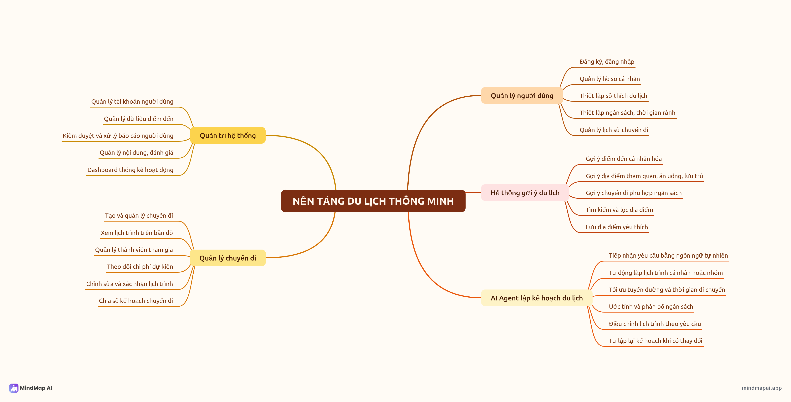
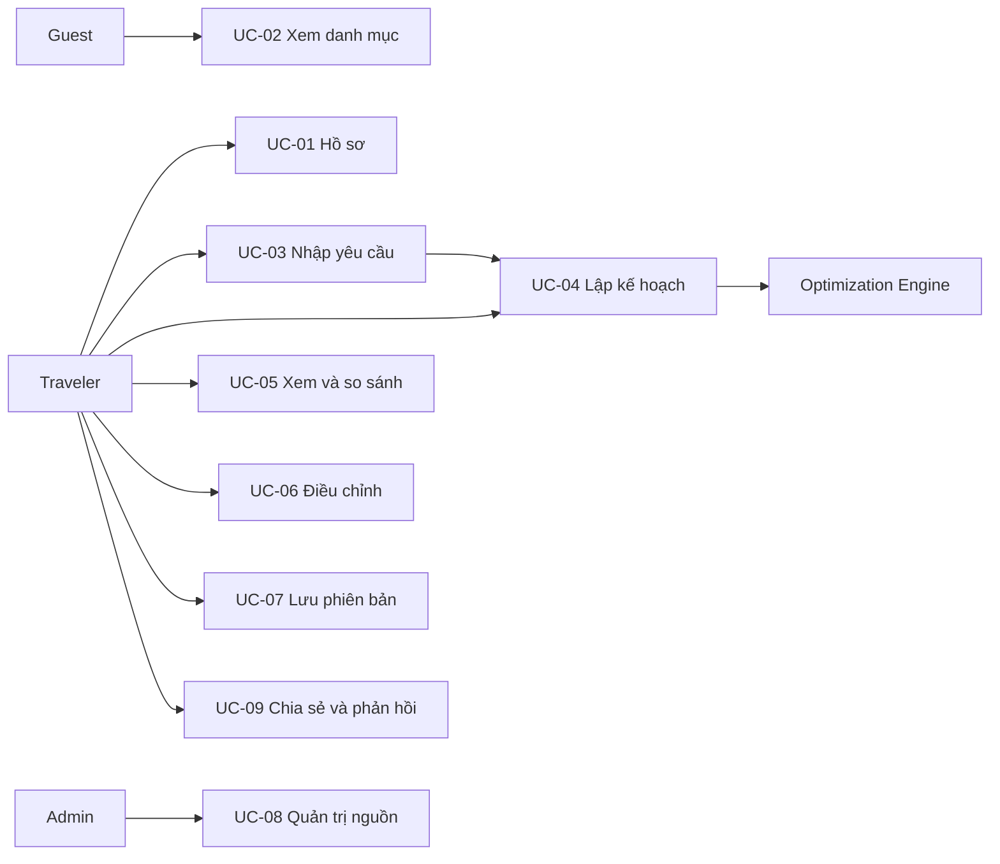
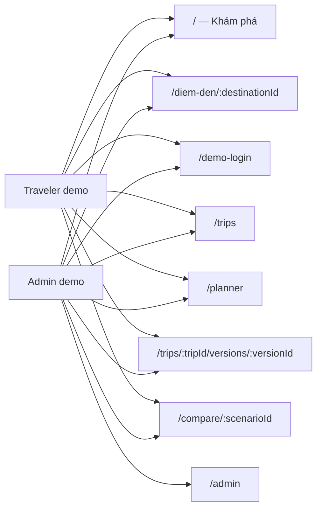
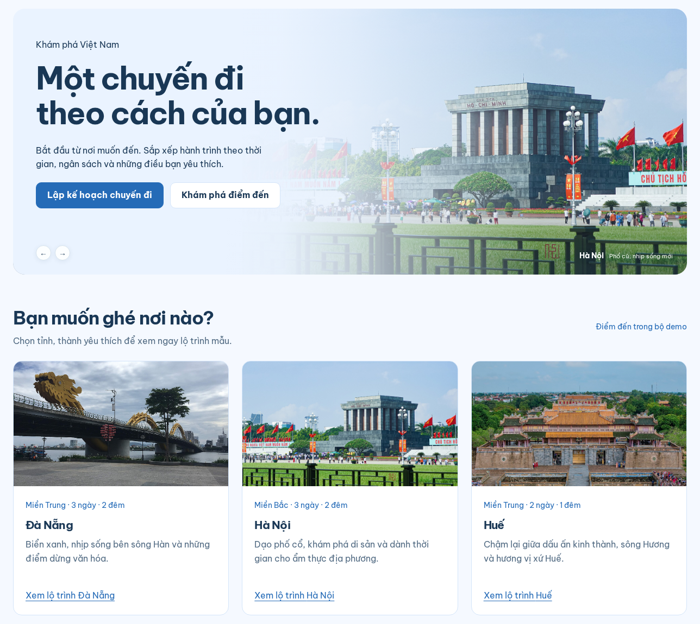
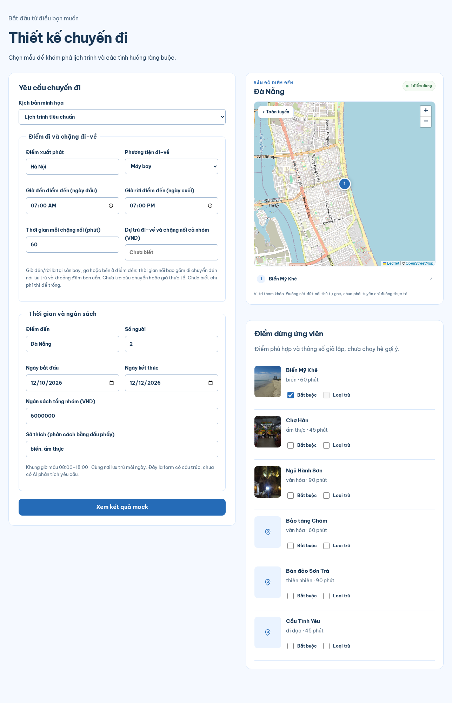
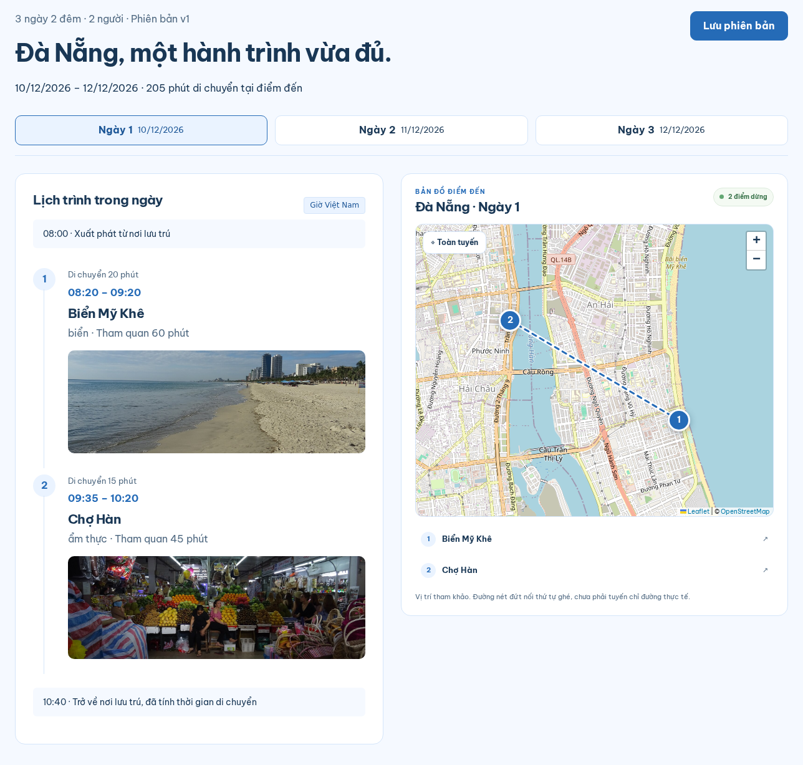
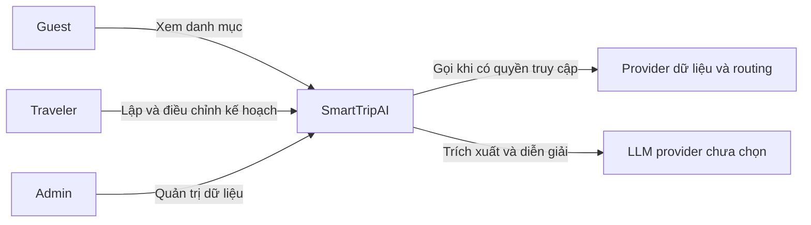
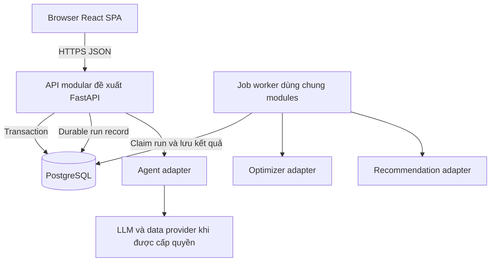
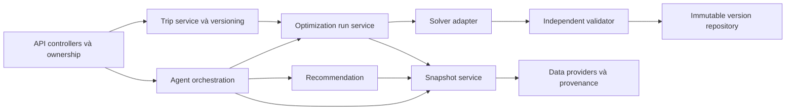
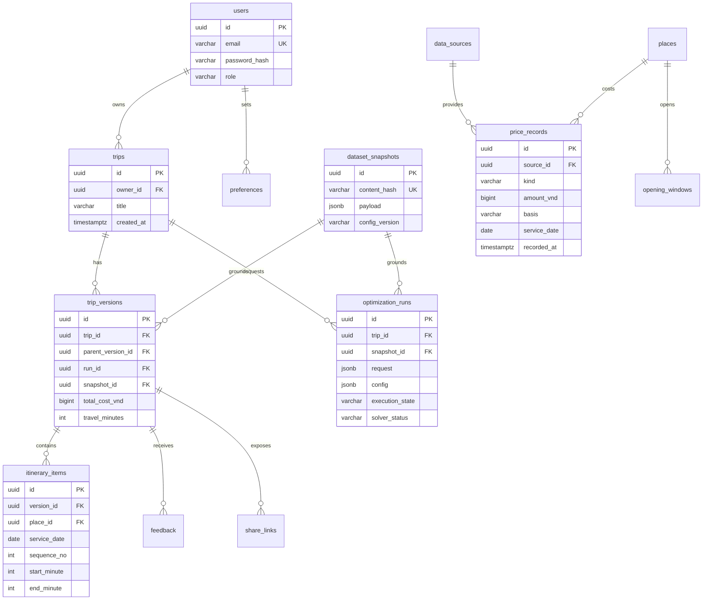

# SmartTripAI — Nền tảng du lịch thông minh

Nền tảng hỗ trợ người dùng lập kế hoạch du lịch tự túc tại Việt Nam, kết hợp **Recommendation System**, **Optimization Engine** và **AI Travel Agent**. Hệ thống hướng đến lịch trình cá nhân hóa có thể kiểm tra theo thời gian, tuyến đường và ngân sách; người dùng có thể lưu và điều chỉnh khi nhu cầu thay đổi.

> Phạm vi hiện tại: **bộ tài liệu phân tích–thiết kế và FE prototype dùng dữ liệu mock**. Backend, hệ gợi ý, AI Agent và thuật toán tối ưu chưa được triển khai thực tế.

---

## 1. Phân tích đề bài Top-Down (Research)

Hệ thống được phân tích theo hướng **Top-Down**, xuất phát từ việc chuẩn bị một chuyến du lịch tự túc:

- **Bối cảnh & Vấn đề tồn tại:** Người dùng tìm địa điểm, giờ hoạt động, nơi ăn ở và chi phí từ nhiều nguồn, sau đó tự sắp xếp thứ tự tham quan. Lịch trình có thể vượt ngân sách, không đủ thời gian hoặc di chuyển vòng vèo.
- **Giải pháp SmartTripAI:** Phối hợp ba thành phần có trách nhiệm riêng:
  1. **Recommendation System:** Xếp hạng điểm đến và hoạt động theo sở thích, ngân sách và điều kiện chuyến đi.
  2. **Optimization Engine — trọng tâm đề tài:** Chọn địa điểm, phân ngày và tối ưu thứ tự ghé dưới ràng buộc thời gian, giờ hoạt động, chi phí và điểm bắt buộc/loại trừ.
  3. **AI Travel Agent:** Tiếp nhận yêu cầu, hỏi dữ kiện thiếu, điều phối công cụ và giải thích phương án; không tự sinh số liệu giá, khoảng cách hoặc giờ hoạt động không có căn cứ.
  4. **Quản lý chuyến đi:** Xem lịch theo ngày, dự toán chi phí, tuyến tham quan và lưu các phiên bản điều chỉnh.

### Sơ đồ tư duy & Cấu trúc sản phẩm (Product Mind Map)

Chi tiết phạm vi, tính năng, nguồn dữ liệu dự kiến và phân kỳ:

- [01-SCOPE.md](docs/01-SCOPE.md)
- [02-FEATURES.md](docs/02-FEATURES.md)

---

## 2. Use Case Diagram & User Stories INVEST

### 2.1 Sơ đồ Use Case Tổng thể (Use Case Diagram)

Các use case bao gồm hồ sơ, danh mục, nhập yêu cầu, lập lịch, kiểm tra kết quả, điều chỉnh, lưu phiên bản và quản trị nguồn. Mỗi use case có tiền/hậu điều kiện, luồng chính và luồng ngoại lệ.

Chi tiết: [03-USE_CASES.md](docs/03-USE_CASES.md).

### 2.2 Danh mục User Stories & Kiểm định Chuẩn INVEST

| Story | Nội dung |
|---|---|
| US-01 | Hồ sơ và sở thích du lịch |
| US-02 | Tra cứu danh mục địa điểm và nguồn |
| US-03 | Xác nhận yêu cầu và ràng buộc chuyến đi |
| US-04 | Tạo lịch trình nhiều ngày khả thi |
| US-05 | Giải thích xung đột và trạng thái chưa tìm được nghiệm |
| US-06 | Kiểm tra dự toán, xem và so sánh lịch trình |
| US-07 | Điều chỉnh kế hoạch, giữ phần lịch đã khóa |
| US-08 | Lưu và mở lại phiên bản chuyến đi |
| US-09 | Quản trị danh mục và nguồn dữ liệu |
| US-10 | Chia sẻ chỉ đọc và phản hồi — chỉ đặc tả target |

| Tiêu chí | Áp dụng trong SmartTripAI |
|---|---|
| **Independent (Độc lập)** | Story có giá trị đầu cuối, phụ thuộc nghiệp vụ tối thiểu được chỉ rõ. |
| **Negotiable (Thương lượng)** | Bố cục và cách triển khai linh hoạt, giữ nguyên ý nghĩa ràng buộc. |
| **Valuable (Có giá trị)** | Giúp người dùng lập, hiểu và quản lý chuyến đi hoặc kiểm soát dữ liệu. |
| **Estimable (Ước lượng được)** | Có input/output, vai trò, phụ thuộc và kịch bản lỗi. |
| **Small (Vừa vặn)** | Mỗi story tập trung một năng lực, phần solver thật có thể chia nhỏ khi triển khai. |
| **Testable (Kiểm thử được)** | Có acceptance criteria quan sát được và mapping tới luồng demo/API. |

Chi tiết backlog, acceptance criteria và truy vết: [INVEST_REQUIREMENTS.md](docs/INVEST_REQUIREMENTS.md).

### 2.3 Phân quyền người dùng (Roles & Permissions)

| Quyền hạn / Khả năng | Guest | Traveler | Admin |
|---|---|---|---|
| Xem danh mục công khai | Có | Có | Có |
| Quản lý hồ sơ | Không | Của mình | Của mình |
| Tạo, lưu và điều chỉnh chuyến đi | Không | Của mình | Của mình |
| Xem lịch trình được chia sẻ | Link còn hiệu lực | Chủ chuyến hoặc link hợp lệ | Chủ chuyến hoặc link hợp lệ |
| Quản trị danh mục và nguồn | Không | Không | Có |
| Xem vận hành đã khử dữ liệu nhạy cảm | Không | Không | Có |

Backend target phải thực thi ownership và quyền ở API/DB. Admin không mặc nhiên được đọc chuyến đi riêng của người khác. Chọn vai trò trên FE hiện tại chỉ phục vụ demo.

---

## 3. Information Architecture & Phân Quyền Màn Hình (Role-to-Screen)

### 3.1 Sơ đồ Phân quyền Vai trò tới Màn hình (Role-to-Screen Mapping)

### 3.2 Bảng Ma trận Màn hình theo Vai trò

| Tuyến đường | Màn hình | Chức năng chính | Traveler demo | Admin demo |
|---|---|---|---|---|
| `/` | Khám phá | Thẻ tỉnh/thành, lịch mẫu và cẩm nang | Có | Có |
| `/diem-den/:destinationId` | Lộ trình tham khảo | Hà Nội và Huế; nội dung minh họa theo ngày | Có | Có |
| `/demo-login` | Chọn hồ sơ | Chuyển vai trò mô phỏng | Có | Có |
| `/trips` | Chuyến đi của bạn | Chuyến mẫu, phiên bản lưu trên thiết bị | Có | Có |
| `/planner` | Lập kế hoạch | Điểm đi, chặng đi–về, dự trù và ràng buộc tại điểm đến | Có | Có |
| `/trips/:tripId/versions/:versionId` | Chi tiết lịch trình | Toàn hành trình nếu có dữ liệu đi–về, timeline, dự toán và kiểm tra | Có | Có |
| `/compare/:scenarioId` | So sánh lịch mẫu | Baseline/proposed cùng request và snapshot | Có | Có |
| `/admin` | Quản trị dữ liệu | Xem danh mục và nguồn mock | Không | Có |

Chi tiết sitemap, vòng đời run và phiên bản: [04-INFORMATION_ARCHITECTURE.md](docs/04-INFORMATION_ARCHITECTURE.md).

---

## 4. Giao diện Người dùng & Trải nghiệm (UI/UX)

### 4.1. Khám phá điểm đến

Trang chủ `/` có slideshow tự chuyển ảnh, nút chuyển trái/phải nhỏ gọn, các điểm đến và lịch trình mẫu. Chọn Đà Nẵng để mở lịch demo; Hà Nội và Huế có lộ trình tham khảo riêng. Người dùng có thể khám phá trước khi chọn hồ sơ demo.

Xem giao diện: Khám phá điểm đến

### 4.2. Lập kế hoạch chuyến đi

Trang `/planner` cho nhập điểm xuất phát, phương tiện, thời gian đến–về, ngày đi, số người, ngân sách và sở thích. Danh sách ứng viên cho chọn điểm bắt buộc/loại trừ; bản đồ hiển thị các điểm đang chọn.

Prototype kiểm tra giờ đến–về có phù hợp lịch mẫu và thông báo khi yêu cầu ngoài fixture; chưa tự sắp lại lịch hay lấy giá qua API.

Xem giao diện: Lập kế hoạch

### 4.3. Lịch trình theo ngày và bản đồ điểm đến

Trang `/trips/:tripId/versions/:versionId` hiển thị **timeline bên trái, bản đồ Leaflet/OpenStreetMap bên phải**. Ghim đánh số theo thứ tự ghé; chọn ngày để cập nhật lịch và bản đồ, bấm tên điểm để mở thông tin vị trí.

Thông tin đi–về, dự toán và báo cáo ràng buộc nằm dưới khu vực tham quan. Giá và lịch vẫn là fixture; vị trí tham khảo và tuyến nét đứt là đường nối minh họa, chưa phải chỉ đường thực tế. Khoản đi–về để trống được hiểu là chưa biết chi phí.

Xem giao diện: Lịch trình và bản đồ

### Các màn hình hỗ trợ

- `/trips`: lưu và mở lại phiên bản trong localStorage; thông tin đi–về được lưu theo chuyến/phiên bản.
- `/compare/:scenarioId`: so sánh hai lịch mẫu cùng request và snapshot; chưa phải benchmark thuật toán.
- `/demo-login`: chọn hồ sơ traveler/admin mô phỏng.
- `/admin`: admin demo xem danh mục và nguồn; chưa cập nhật dữ liệu qua backend.
- `/diem-den/:destinationId`: xem lộ trình tham khảo tại Hà Nội hoặc Huế.

Cách chạy frontend và kịch bản demo: [frontend/README.md](frontend/README.md). Chụp lại bộ ảnh bằng `cd frontend && node scripts/capture-readme.mjs`; script tự mở máy chủ cục bộ hoặc dùng `SMARTTRIP_URL` nếu đã có server.

---

## 5. Kiến trúc Hệ thống (C4 Model Architecture)

Hệ thống được mô tả theo C4; các sơ đồ backend/database là **kiến trúc target**, còn prototype hiện tại chỉ gồm React, fixture và localStorage.

- **C1: System Context** — Người dùng, quản trị viên và nguồn dữ liệu/LLM bên ngoài chưa lựa chọn nhà cung cấp.
- **C2: Container** — React SPA, API modular đề xuất FastAPI, job worker và PostgreSQL ở thiết kế target.
- **C3: Component** — Trip service, recommendation, agent orchestration, Optimization Engine, validator, dữ liệu và repository.
- **C4: Code Mapping** — Interface target và ánh xạ module FE prototype, không coi mock service là solver.

### 5.1 C1 — System Context Diagram

### 5.2 C2 — Container Diagram

### 5.3 C3 — Component Diagram

**Trọng tâm Optimization Engine:** mô hình chọn điểm/phân ngày/tuyến với giờ hoạt động và ngân sách; ràng buộc cứng, hàm mục tiêu, baseline greedy, hướng CP-SAT và validator độc lập. Điều chỉnh giữ nguyên prefix đã thực hiện, tạo version mới. Phân biệt có nghiệm, tối ưu đã chứng minh, vô nghiệm đã chứng minh và hết thời gian chưa tìm được nghiệm.

Chi tiết kiến trúc:

- [Tổng quan C4](docs/architecture/c4/README.md)
- [01-CONTEXT.md](docs/architecture/c4/01-CONTEXT.md)
- [02-CONTAINER.md](docs/architecture/c4/02-CONTAINER.md)
- [03-COMPONENT.md — gồm đặc tả Optimization Engine](docs/architecture/c4/03-COMPONENT.md)
- [04-CODE.md](docs/architecture/c4/04-CODE.md)

---

## 6. Thiết kế Cơ sở Dữ liệu (Database Design & ERD)

Thiết kế dự kiến dùng PostgreSQL, tách danh mục live, snapshot dữ liệu, yêu cầu chạy tối ưu và các phiên bản lịch trình bất biến. Dữ liệu giá phân biệt observed/estimated/simulated và per_person/per_group. FE hiện tại chưa kết nối database.

### 6.1 Sơ đồ Thực thể Quan hệ (Mermaid Entity Relationship Diagram — ERD)

Các bảng chính: users, preferences, trips, trip_versions, optimization_runs, itinerary_items, places, opening_windows, price_records, data_sources, dataset_snapshots, feedback và share_links. Quan hệ parent version/run/snapshot phải cùng chuyến đi; không lưu plan vi phạm ràng buộc thành version khả thi.

Chi tiết khóa, trường dữ liệu, tính nhất quán, index và retention: [DATABASE_DESIGN.md](docs/architecture/DATABASE_DESIGN.md).

---

## 7. Đặc tả Giao tiếp API (OpenAPI 3.1 Specification)

Hợp đồng target giữa Web Frontend và Backend dùng REST/JSON, Bearer authentication và problem+json. API hiện mới được đặc tả và kiểm tra schema; frontend dùng mock service.

### 7.1 Ma trận Nhóm Endpoints Cốt lõi

Các route dưới đây có prefix `/api/v1`.

| Nhóm chức năng | Phương thức & Tuyến đường | Quyền hạn target | Nhiệm vụ chính |
|---|---|---|---|
| Xác thực & Hồ sơ | `POST /auth/login`, `GET/PATCH /profile` | Public / chính mình | Xác thực, hồ sơ và sở thích |
| Danh mục địa điểm | `GET /places` | Public | Snapshot danh mục và provenance |
| Quản lý chuyến đi | `GET/POST /trips`, `GET /trips/{tripId}` | Chủ chuyến | Tạo và xem chuyến đi |
| Tối ưu & Điều chỉnh | `POST /trips/{tripId}/runs`, `GET /trips/{tripId}/runs/{runId}` | Chủ chuyến | Lập lịch, replanning, theo dõi trạng thái và lý do |
| Phiên bản lịch trình | `GET /trips/{tripId}/versions`, `GET /trips/{tripId}/versions/{versionId}` | Chủ chuyến | Lưu kết quả bất biến và xem lịch sử |
| Chia sẻ & Phản hồi | `POST /trips/{tripId}/shares`, `DELETE /trips/{tripId}/shares/{shareId}`, `GET /shares/{shareToken}`, `POST /trips/{tripId}/feedback` | Chủ chuyến / token hợp lệ | Link chỉ đọc có hạn, thu hồi và feedback; chưa có FE |
| Quản trị dữ liệu | `GET/POST /admin/sources`, `PUT /admin/places/{placeId}`, `POST /admin/snapshots` | Admin | Quản trị nguồn/danh mục, publish snapshot mới |

Tài liệu đặc tả:

- [OPENAPI_SPECIFICATION.md](docs/architecture/OPENAPI_SPECIFICATION.md) — Quy tắc nghiệp vụ, lỗi, ownership và request mẫu.
- [openapi.yaml](docs/api/openapi.yaml) — Hợp đồng OpenAPI 3.1, schema request/result/plan, sẵn để xem bằng công cụ hỗ trợ OpenAPI.
