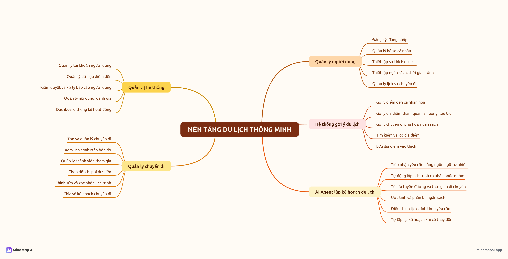

# 02 — Chức năng và functional mind map

| ID | Năng lực | MVP target | FE hiện tại |
|---|---|---|---|
| F-01 | Hồ sơ, sở thích và định danh | Có | Chọn vai trò demo, không auth |
| F-02 | Tra cứu địa điểm và nguồn | Có | Danh mục fixture |
| F-03 | Recommendation cá nhân hóa | Content-based | Điểm phù hợp mẫu |
| F-04 | Tiếp nhận yêu cầu có cấu trúc/ngôn ngữ tự nhiên | Form + agent hỏi lại | Form + mô tả ví dụ, không NLP |
| F-05 | Optimization Engine nhiều ngày | Trọng tâm | Lịch mẫu đã kiểm tra dữ liệu |
| F-06 | Dự toán tổng nhóm và theo người | Có | Cộng khoản chi fixture |
| F-07 | Phát hiện xung đột/timeout/lỗi dữ liệu | Có | Tình huống chọn sẵn |
| F-08 | Replanning và lưu phiên bản | Có | Phiên bản mẫu và localStorage |
| F-09 | Lịch ngày, tuyến và so sánh | Có | Timeline, SVG mô phỏng, so sánh mẫu |
| F-10 | Quản trị danh mục/nguồn/lần chạy | Có | Xem dữ liệu và nguồn demo |
| F-11 | Chia sẻ chuyến đi và phản hồi | Target MVP đơn giản | Chỉ đặc tả API, chưa demo |
| F-12 | Cộng tác nhóm, CF/hybrid, nhiều thành phố | Sau MVP | Không |

Phụ thuộc: F-05 cần snapshot từ F-02 và điểm ứng viên F-03; F-04 gọi F-05 thông qua contract, không can thiệp phép tính; F-08 tạo version mới, không sửa kết quả cũ. Chi tiết [stories](INVEST_REQUIREMENTS.md).
