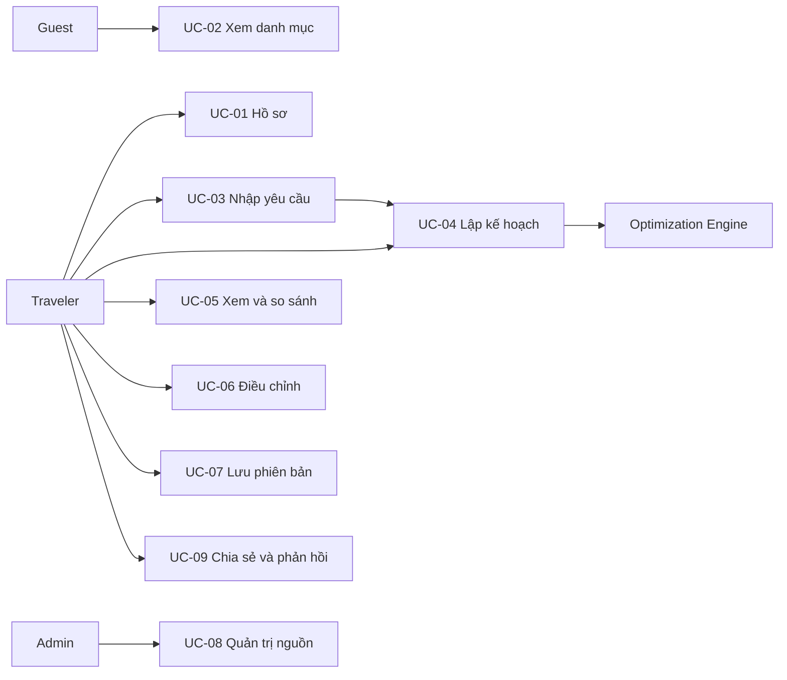

# 03 — Use cases và quy tắc nghiệp vụ

## Vai trò và quyền target
| Hành động | Guest | Traveler | Admin |
|---|---|---|---|
| Xem danh mục công khai | Có | Có | Có |
| Sửa hồ sơ/lập/lưu chuyến đi | Không | Của mình | Của mình |
| Xem chuyến được chia sẻ | Token hợp lệ | Token hợp lệ hoặc chủ | Token hợp lệ hoặc chủ |
| Quản trị địa điểm/nguồn | Không | Không | Có |
| Xem vận hành đã khử dữ liệu nhạy cảm | Không | Không | Có |

Admin không mặc nhiên đọc chuyến riêng người khác. Backend phải kiểm tra ownership từng request; role demo trên FE không thực thi bảo mật.

## Business rules
| ID | Quy tắc |
|---|---|
| BR-01 | Ngân sách là tổng VND nguyên cho cả nhóm; số người nguyên dương; thời gian theo Asia/Ho_Chi_Minh |
| BR-02 | Mỗi điểm ghé tối đa một lần trong chuyến; mọi ngày bắt đầu/kết thúc tại depot, kể cả ngày rỗng |
| BR-03 | Hard constraints không tự nới: bắt buộc, loại trừ, khung giờ, thời lượng, ngân sách, liên thông |
| BR-04 | Snapshot/plan version bất biến; replan tạo version mới và giữ phần đã khóa |
| BR-05 | Giá có loại observed/estimated/simulated, nguồn, ghi nhận, ngày áp dụng và basis per_person/per_group |
| BR-06 | Thiếu dữ liệu bắt buộc trả DATA_ERROR; không tự dùng khoảng cách đường chim bay như thời gian tuyến thật |
| BR-07 | TIMEOUT_NO_SOLUTION không phải INFEASIBLE; OPTIMAL cần chứng cứ từ solver |
| BR-08 | Chỉ chủ sở hữu quản lý trip; shared link chỉ đọc, có hạn và thu hồi được |
| BR-09 | Đề xuất AI chưa được người dùng xác nhận không thành ràng buộc chính thức |
| BR-10 | So sánh công bằng cần cùng request, snapshot, cấu hình và time budget; mock không phải benchmark |

## Sơ đồ tổng thể

## Đặc tả
### UC-01 — Hồ sơ và sở thích
Actor traveler; tiền điều kiện đã xác thực ở target. Đọc hồ sơ → sửa sở thích → validate → lưu. Hậu điều kiện hồ sơ cập nhật, lịch cũ không tự thay đổi. Ngoại lệ phiên hết hạn → 401; sở thích không hợp lệ → 422; FE chọn hồ sơ demo thay bước đăng nhập.

### UC-02 — Tra cứu địa điểm
Actor guest/traveler; danh mục công khai. Chọn điểm đến → lọc danh mục → xem thời lượng, giờ và provenance. Kết quả là tập ứng viên, chưa phải tuyến. Không có dữ liệu → empty state; dữ liệu cũ → cảnh báo, không khẳng định giá hiện tại.

### UC-03 — Nhập yêu cầu
Actor traveler. Nhập ngày, số người, ngân sách nhóm, depot, khung giờ, sở thích và điểm bắt buộc/loại trừ. Target agent có thể phân tích câu tự nhiên nhưng phải hỏi dữ kiện thiếu và yêu cầu xác nhận. Validate ngày, ngân sách, trùng điểm và giao nhau hai tập trước khi gửi. FE chỉ hỗ trợ các request fixture và báo unsupported nếu khác.

### UC-04 — Lập kế hoạch
Tiền điều kiện request đã xác nhận, trip thuộc actor, snapshot đầy đủ. Ghi run → lấy ứng viên/ràng buộc → solver → validator độc lập → lưu version bất biến → trả lịch, chi phí và kiểm tra. Target trả 202 và polling run; FE mô phỏng chờ ngắn. Hậu điều kiện chỉ version hợp lệ được lưu; không có nghiệm vẫn giữ run để giải thích. Ngoại lệ DATA_ERROR khi thiếu ma trận/giờ; INVALID_INPUT khi xung đột đầu vào; INFEASIBLE khi chứng minh không thể; timeout có/không nghiệm phải tách biệt. Không trả lịch vi phạm như lịch khả thi.

### UC-05 — Xem và so sánh
Đọc version có quyền → xem ngày, timeline, tổng nhóm/người và nguồn → xem baseline/proposed cùng snapshot/request. Cảnh báo nếu chỉ là mock. Khi khác snapshot/request không đưa phần trăm cải thiện. Không có version → hướng về lập kế hoạch; ID không tồn tại → not found.

### UC-06 — Điều chỉnh kế hoạch
Tiền điều kiện có version gốc. Chọn thay đổi, khóa điểm đã thực hiện → xác nhận request mới → tạo run với parentVersionId → giữ nguyên phần khóa → kết quả thành version con. Xung đột phần khóa trả lỗi giải thích, không sửa version cha. Timeout chưa có nghiệm giữ lịch cũ để người dùng tiếp tục xem.

### UC-07 — Lưu và mở lại
Chủ chuyến lưu một version → đọc lại từ lịch sử. Cùng versionId lưu lại là idempotent; version mới không ghi đè version trước. FE localStorage lỗi/quota/hỏng/schema cũ phải thông báo, cho reset riêng dữ liệu demo, không xóa dữ liệu ứng dụng khác.

### UC-08 — Quản trị dữ liệu
Admin xem nguồn → cập nhật bản ghi địa điểm/giờ/giá → validate provenance → tạo snapshot mới. Không sửa snapshot đã dùng trong run. Nguồn chưa xác minh giữ trạng thái unverified, không được tuyên bố có quyền thương mại. FE chỉ xem danh mục/nguồn.

### UC-09 — Chia sẻ và phản hồi (chỉ target)
Chủ tạo link chỉ đọc có expiresAt; người nhận chỉ thấy dữ liệu đã cho phép. Chủ thu hồi link; token hết hạn trả 404 để tránh tiết lộ. Traveler gửi đánh giá hữu ích/not useful cho version; không dùng feedback để tự khẳng định thuật toán chính xác. FE chưa triển khai.

Tham chiếu: [Optimization](architecture/c4/03-COMPONENT.md), [API](architecture/OPENAPI_SPECIFICATION.md).
