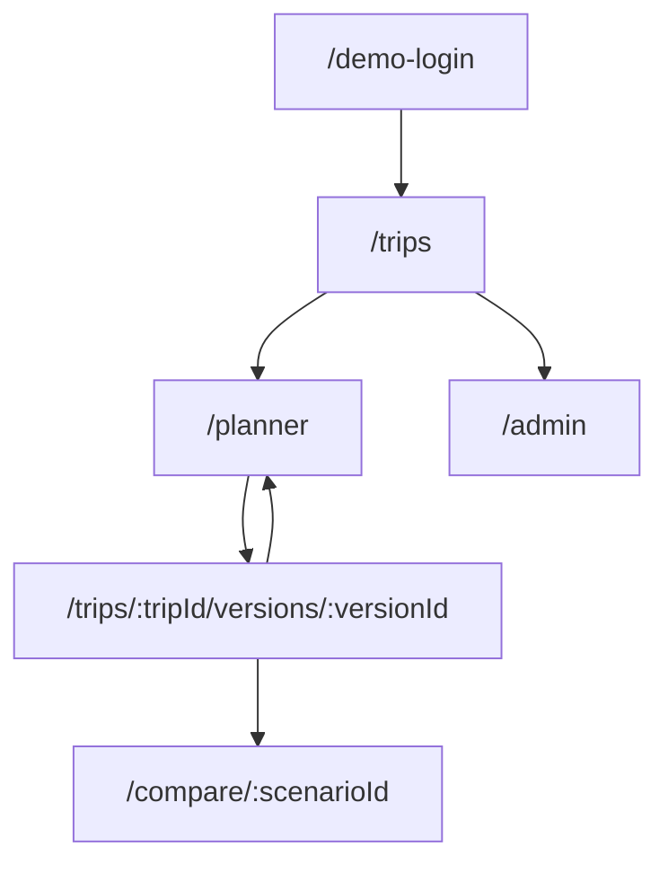
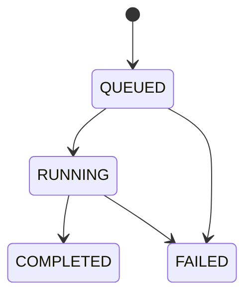

# 04 — Information Architecture

## Sitemap prototype

| Route | Nội dung và quyền demo |
|---|---|
| /demo-login | Chọn traveler/admin, ghi rõ hồ sơ mô phỏng |
| /trips | Chuyến mẫu + phiên bản lưu trong trình duyệt |
| /planner | Yêu cầu có cấu trúc và kịch bản mock; ứng viên và điểm bắt buộc |
| /trips/:tripId/versions/:versionId | Timeline theo ngày, tiền, constraint report và nguồn; ID không tồn tại báo lỗi |
| /compare/:scenarioId | Baseline/proposed cùng request/snapshot; mock không phải benchmark |
| /admin | Danh mục/nguồn mẫu, chỉ hiển thị khi chọn admin; không phải bảo mật |

Prototype có deep link cho fixture và các phiên bản đã lưu. Không tồn tại route → trang không tìm thấy với link về chuyến đi. Shared links chỉ target, chưa có route demo public riêng.

## Vòng đời target
Trip có thể DRAFT/ARCHIVED; plan version bất biến, không dùng solver status làm trạng thái toàn trip. Run có QUEUED→RUNNING→COMPLETED/FAILED; COMPLETED không bảo đảm có nghiệm. Result có solver status riêng. Một trip có nhiều run và version; run thất bại không xóa version cũ.

Thông tin trình bày theo nhu cầu: yêu cầu trước, lịch theo ngày tiếp theo, rồi kiểm tra chi phí/ràng buộc/nguồn. Thông tin solver dành cho phần giải thích, không chen vào form như các tham số kỹ thuật khó hiểu. Mock label hiện toàn ứng dụng.
