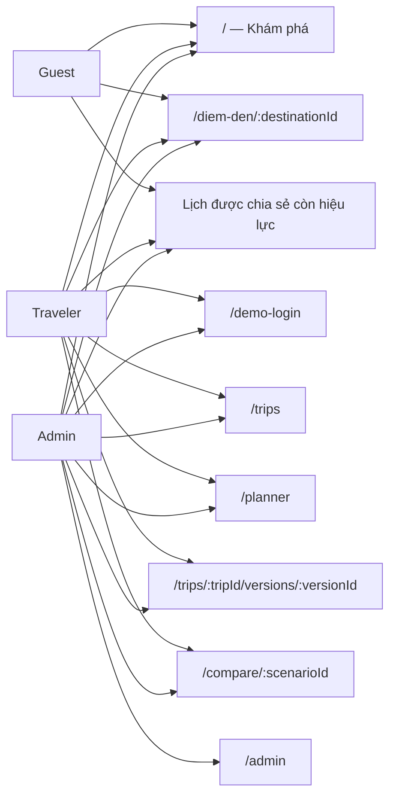
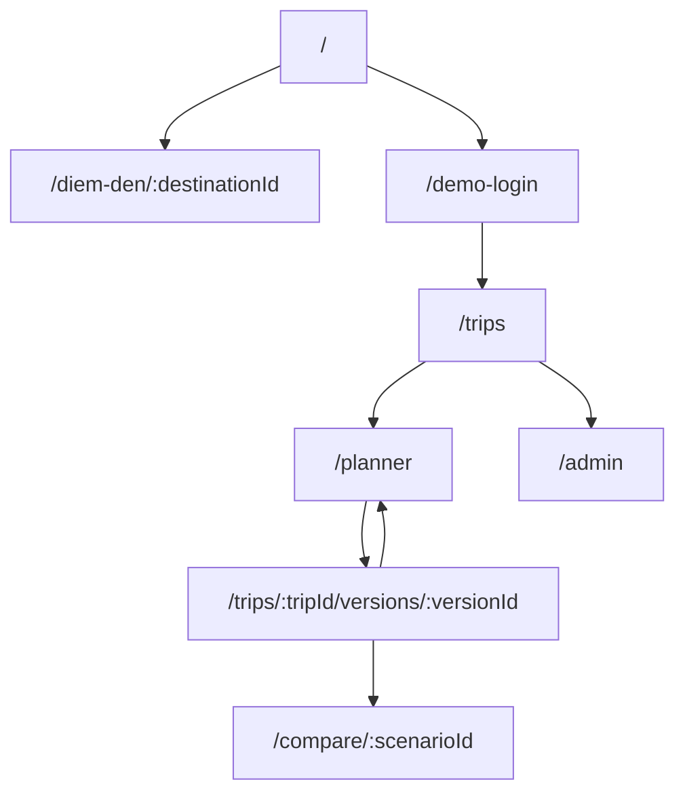
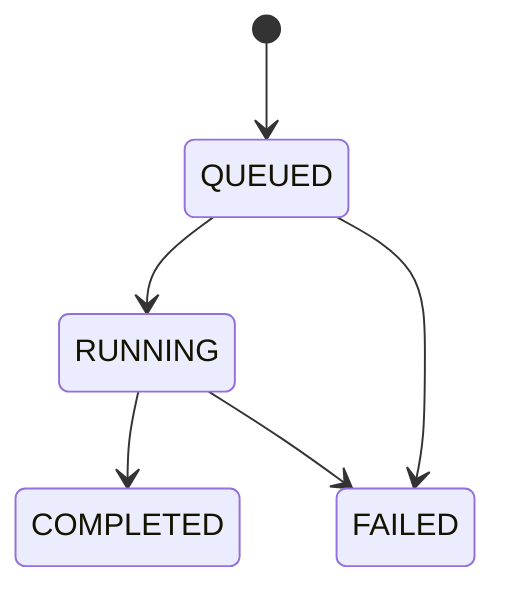

# 04 — Information Architecture

## Người dùng và màn hình được xem

Mỗi mục dưới đây mô tả một người dùng riêng và các màn hình họ được xem. Quyền ở prototype chỉ là điều hướng/trình diễn; không phải kiểm soát bảo mật. Quyền target cần được kiểm tra tại API và cơ sở dữ liệu.

### 1. Khách chưa đăng nhập (Guest)

**Mục đích:** Khám phá nội dung công khai và mở lịch trình được chia sẻ còn hiệu lực.

**Được xem:**

- `/` — Khám phá: danh sách điểm đến, lịch trình mẫu và cẩm nang.
- `/diem-den/:destinationId` — Lộ trình tham khảo công khai.
- Lịch trình từ đường dẫn chia sẻ còn hiệu lực — chỉ xem nội dung được chia sẻ.

**Không được xem:** màn hình hồ sơ, tạo/lưu/điều chỉnh chuyến đi cá nhân và `/admin`.

### 2. Khách du lịch (Traveler)

**Mục đích:** Lập kế hoạch, xem kết quả và quản lý chuyến đi của chính mình.

**Được xem:**

- `/` — Khám phá điểm đến và lịch mẫu.
- `/diem-den/:destinationId` — Lộ trình tham khảo theo ngày.
- `/demo-login` — Chọn hồ sơ mô phỏng; không phải đăng nhập thật.
- `/trips` — Chuyến mẫu và các phiên bản đã lưu trong trình duyệt.
- `/planner` — Nhập điểm đi, thời gian, ngân sách, sở thích và điểm bắt buộc/loại trừ.
- `/trips/:tripId/versions/:versionId` — Chi tiết lịch trình, timeline, dự toán, ràng buộc và nguồn dữ liệu.
- `/compare/:scenarioId` — So sánh hai lịch mẫu có cùng yêu cầu và snapshot.
- Đường dẫn chia sẻ còn hiệu lực — xem lịch được chia sẻ theo phạm vi của đường dẫn.

**Không được xem:** `/admin` và chuyến riêng của người khác nếu không có quyền truy cập/chia sẻ hợp lệ.

### 3. Quản trị viên (Admin)

**Mục đích:** Dùng các chức năng du lịch như traveler và kiểm tra dữ liệu nguồn.

**Được xem:**

- `/`, `/diem-den/:destinationId`, `/demo-login`, `/trips`, `/planner`, `/trips/:tripId/versions/:versionId` và `/compare/:scenarioId` — cùng các màn hình du lịch như traveler; chuyến riêng vẫn theo quyền sở hữu hoặc chia sẻ hợp lệ.
- `/admin` — Danh mục địa điểm và nguồn dữ liệu mock; prototype hiện chỉ hiển thị, chưa cập nhật dữ liệu thật.
- Màn hình vận hành đã khử dữ liệu nhạy cảm — thuộc phạm vi target, chưa có trong prototype hiện tại.

**Không mặc nhiên được xem:** chuyến đi riêng của traveler khác chỉ vì có vai trò admin.

### Sơ đồ quyền xem màn hình

### Ma trận màn hình

| Route/màn hình | Guest | Traveler | Admin | Ghi chú |
|---|---:|---:|---:|---|
| `/` — Khám phá | Có | Có | Có | Nội dung công khai |
| `/diem-den/:destinationId` — Lộ trình tham khảo | Có | Có | Có | Nội dung minh họa theo ngày |
| `/demo-login` — Chọn hồ sơ demo | Không | Có | Có | Chuyển vai trò mô phỏng |
| `/trips` — Chuyến đi | Không | Có | Có | Phiên bản lưu cục bộ; quyền sở hữu target vẫn áp dụng |
| `/planner` — Lập kế hoạch | Không | Có | Có | Form yêu cầu và điểm dừng ứng viên |
| `/trips/:tripId/versions/:versionId` — Chi tiết lịch | Theo link chia sẻ | Có quyền | Có quyền | Không tồn tại hoặc không có quyền thì không hiển thị dữ liệu |
| `/compare/:scenarioId` — So sánh lịch mẫu | Không | Có | Có | Chỉ so sánh fixture demo |
| `/admin` — Quản trị dữ liệu | Không | Không | Có | Prototype chỉ xem danh mục/nguồn mock |
| Màn hình vận hành đã khử dữ liệu | Không | Không | Target | Chưa được triển khai trong prototype |

## Sitemap prototype

Prototype có deep link cho fixture và phiên bản đã lưu. Route không tồn tại hiển thị trang không tìm thấy kèm đường về chuyến đi. Shared links hiện chưa có route public demo riêng.

## Vòng đời target

Trip có thể DRAFT/ARCHIVED; plan version bất biến, không dùng solver status làm trạng thái toàn trip. Run có QUEUED→RUNNING→COMPLETED/FAILED; COMPLETED không bảo đảm có nghiệm. Result có solver status riêng. Một trip có nhiều run và version; run thất bại không xóa version cũ.

Thông tin trình bày theo nhu cầu: yêu cầu trước, lịch theo ngày tiếp theo, rồi kiểm tra chi phí/ràng buộc/nguồn. Thông tin solver dành cho phần giải thích, không chen vào form như các tham số kỹ thuật khó hiểu. Mock label hiện toàn ứng dụng.
