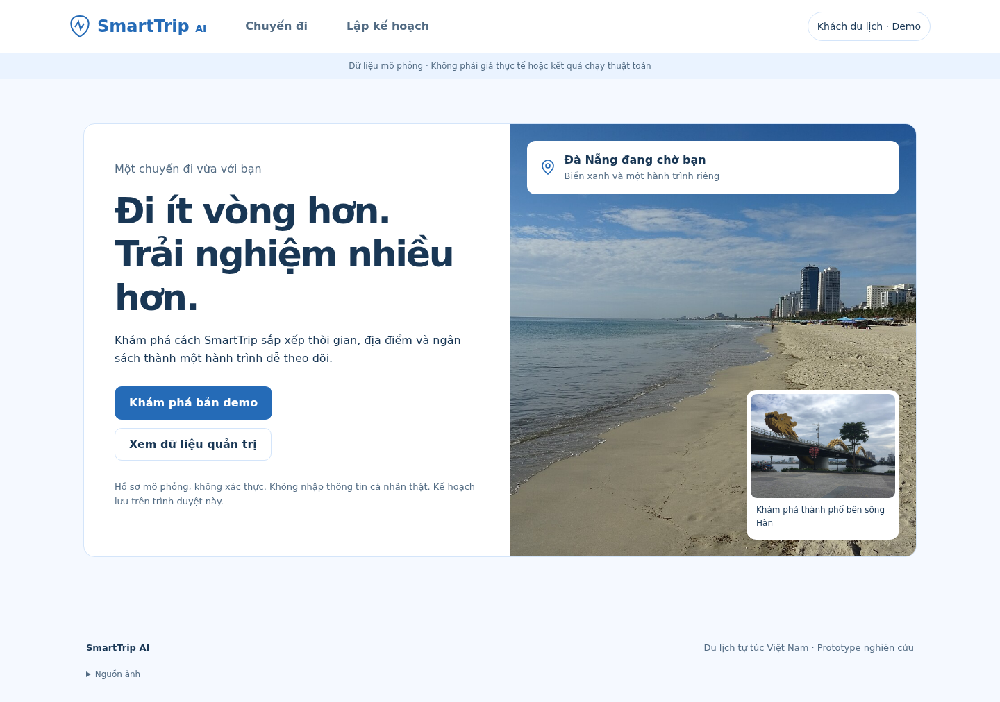
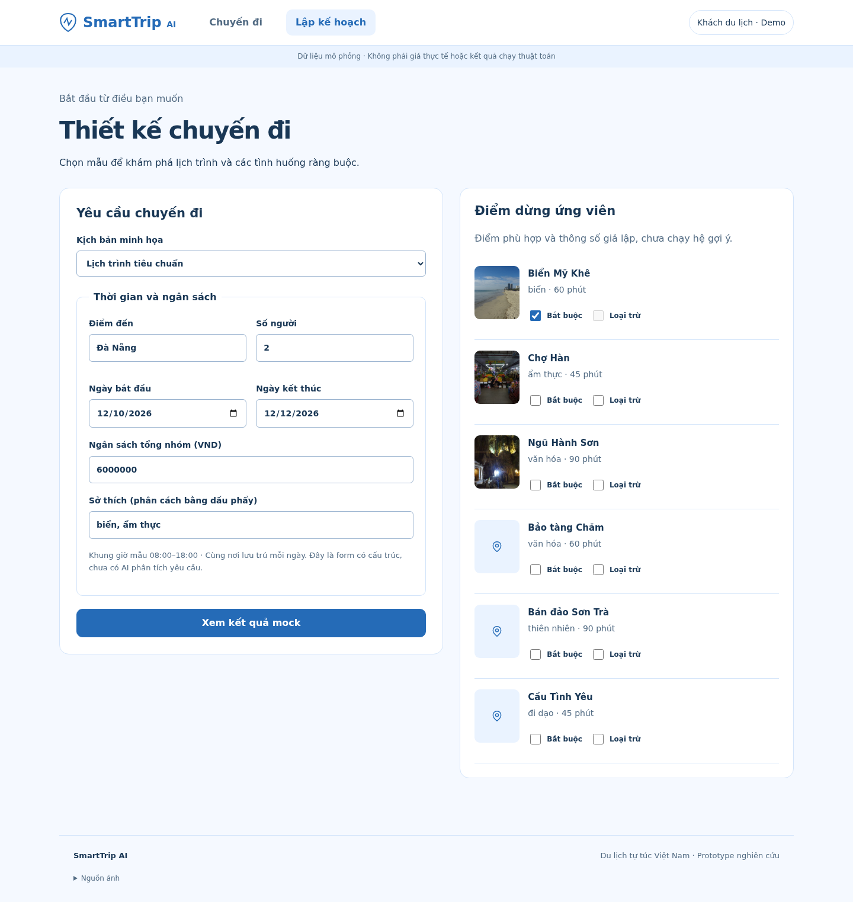
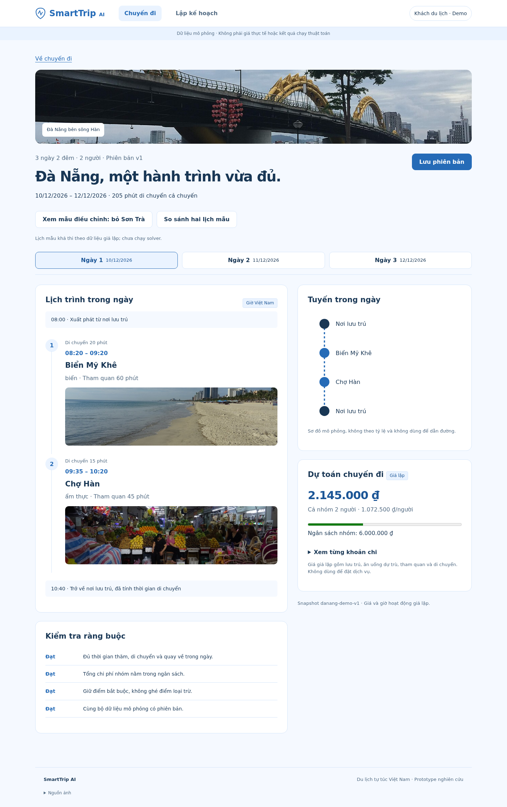
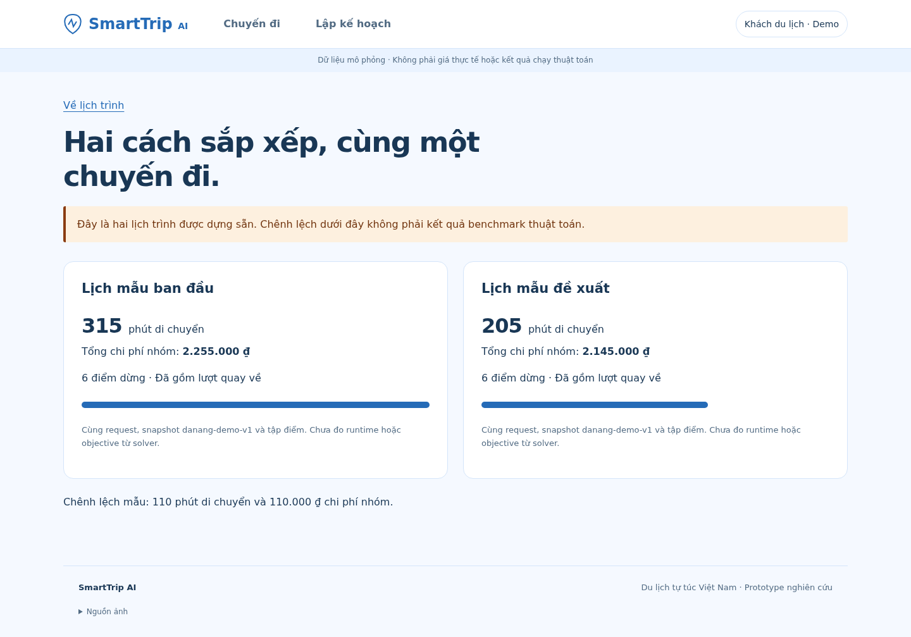
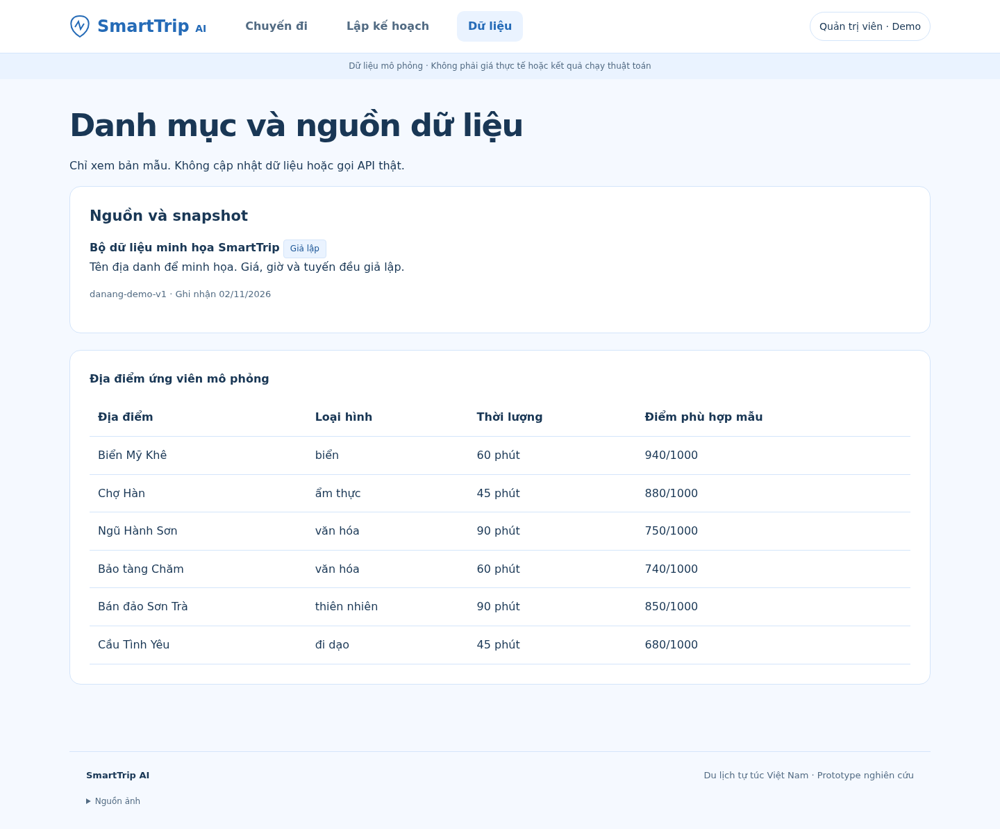
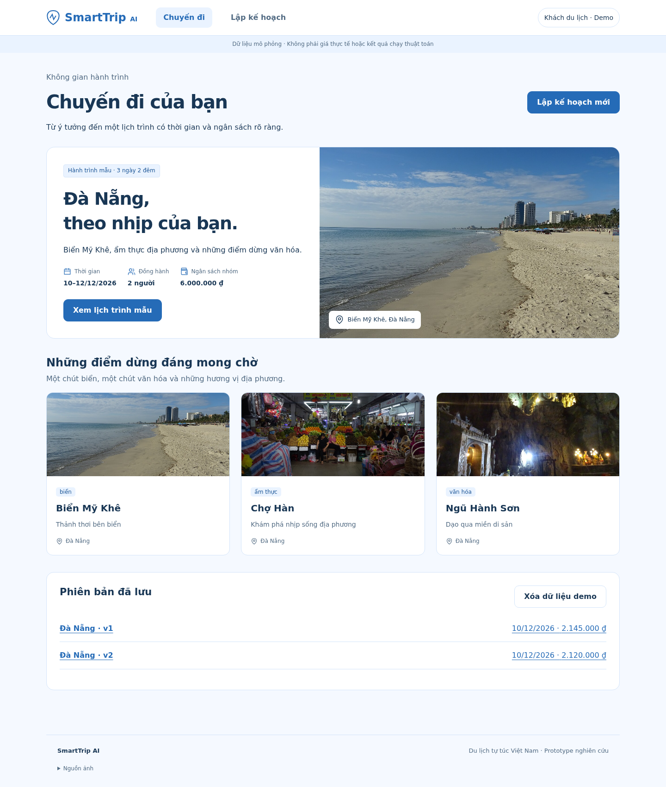

# 05 — Thiết kế UX/UI SmartTrip AI

**Phong cách:** xanh dương nhẹ + trắng, có ảnh địa điểm, ưu tiên khả năng lập và đọc lịch trình.
**Phạm vi:** FE prototype mock; các luồng nghiệp vụ giữ theo đặc tả đã thống nhất.

## 1. Định hướng thị giác

Giao diện mang cảm giác chuẩn bị một chuyến đi biển: nền xanh rất nhạt, card trắng, ảnh Đà Nẵng và nút xanh dương rõ ràng. Ảnh tạo cảm hứng ở đầu trang và giúp nhận diện điểm dừng; thông tin ngày, giờ, chi phí nằm trên nền trắng để dễ đọc.

Áp dụng các skill **design**, **design-system**, **frontend-design**, **ui-ux-pro-max**: tổ chức token theo ba lớp; chọn thứ bậc nội dung; phân nhóm thao tác; kiểm tra focus, tương phản và responsive. Gợi ý màu cam/teal hoặc hiệu ứng kể chuyện của thư viện không được áp dụng vì yêu cầu mới là xanh dương nhẹ + trắng và đây là công cụ lập lịch.

## 2. Design tokens

| Primitive | Giá trị | Semantic / Công dụng |
|---|---|---|
| blue-50 | `#F5F9FF` | color-background: nền trang xanh rất nhạt |
| white | `#FFFFFF` | color-surface / card-bg: card và vùng thông tin |
| blue-100 | `#EAF3FF` | color-soft: badge, ngày đang chọn, trạng thái navigation |
| blue-200 | `#D4E5FA` | color-border / card-border: đường phân cách |
| blue-600 | `#256BB7` | color-primary / button-bg: nút chính, tuyến và icon |
| blue-700 | `#1B5596` | color-primary-hover: hover và chữ nhấn mạnh |
| navy-900 | `#193755` | color-ink: nội dung chính |
| slate-600 | `#526B83` | color-muted: chú thích và metadata |

Token nằm trong `frontend/src/styles.css`: primitive → semantic → component. Xanh nhạt dùng cho diện tích nền; chữ/nút dùng xanh đậm hơn để giữ độ rõ. Warning vẫn có chữ và màu cảnh báo riêng; không dùng cùng màu để đồng nhất các trạng thái khác nghĩa.

Typography dùng Segoe UI/system sans hỗ trợ tiếng Việt, không phụ thuộc tải font mạng. H1 28–52px tùy màn hình, H2 21–24px, body 16px, metadata 12–14px. Heading có độ đậm 650, không viết hoa toàn bộ. Nội dung căn trái, tối đa 1240px, khoảng cách theo thang 8/16/24/32px; card thông tin bo 16px, control bo 10px.

## 3. Bố cục và phân nhóm component

| Màn hình | Bố cục desktop | Component và thứ tự ưu tiên |
|---|---|---|
| Chọn hồ sơ | Nội dung trái, ảnh biển phải | Lợi ích chính → CTA traveler → CTA admin thứ cấp → ghi chú demo; ảnh biển + ảnh nhỏ thành phố |
| Chuyến đi | Header hành động, card chuyến nổi bật, gallery, lịch sử | Tên chuyến → thời gian/số người/ngân sách → mở lịch → ba điểm dừng có ảnh → phiên bản đã lưu |
| Lập kế hoạch | Form trái, ứng viên phải | Kịch bản → thời gian/nhóm/ngân sách → sở thích → CTA; mỗi ứng viên có ảnh hoặc icon, thông tin và checkbox chung một nhóm |
| Lịch trình | Ảnh bìa, tiêu đề/hành động, chọn ngày, hai cột | Ngày và số người → lưu/chỉnh/so sánh → timeline có ảnh bên trái; tuyến + dự toán bên phải; constraints dưới timeline |
| So sánh | Hai phương án song song | Cùng request/snapshot → travel/cost → chênh lệch mẫu; nhãn mock rõ |
| Quản trị | Nội dung và bảng trên nền trắng | Nguồn/snapshot → danh mục địa điểm; chỉ xem dữ liệu mẫu |

### Component dùng lại

- `DestinationPhoto`: ảnh cục bộ, alt, kích thước khai báo sẵn, object-fit và lazy loading; ảnh đầu trang tải eager.
- `PlaceGallery`: ba thẻ biển/ẩm thực/văn hóa, ảnh và thông tin cùng địa điểm, không giả làm nút khi không có hành động.
- `Icon`: SVG outline thống nhất, 20px; icon bên cạnh nhãn là decorative.
- `DayTimeline`: số thứ tự thực của các điểm, thời gian đi/thăm/quay về và ảnh khi có đúng địa danh.
- `RouteDiagram`: tuyến sơ đồ dùng token xanh dương, có nội dung văn bản tương đương, không phải bản đồ dẫn đường.
- `BudgetSummary`: tổng nhóm trước, bình quân/người sau, chi tiết trong disclosure; không để ảnh chiếm vùng tài chính.
- `ConstraintReport`: nhãn Đạt/Chưa đạt/Chưa xác định cùng giải thích; không chỉ phân biệt bằng màu.

Ảnh Cầu Rồng dùng làm ảnh giới thiệu thành phố; không gán ảnh đó cho điểm Cầu Tình Yêu trong fixture. Những địa điểm chưa có ảnh dùng icon trung tính thay vì ảnh sai địa danh.

## 4. Minh họa màn hình thực tế

### 4.1 Chọn hồ sơ demo

CTA khách du lịch nổi bật, quản trị là hành động thứ cấp; ảnh tạo bối cảnh chuyến đi.

### 4.2 Lập kế hoạch và chọn ứng viên

Form và danh sách ứng viên đặt cạnh nhau; ảnh nhỏ giúp nhận diện địa điểm mà không đẩy checkbox xa thông tin.

### 4.3 Lịch trình theo ngày

Ảnh bìa thành phố, thanh chọn ngày, timeline có ảnh và cột dự toán/tuyến riêng.

### 4.4 So sánh hai phương án mẫu

Hai phương án cùng cấp thị giác, nhãn dữ liệu mẫu đặt trước chỉ số để người xem hiểu đúng.

### 4.5 Quản trị nguồn dữ liệu

Bảng đọc được và bố cục tiết chế, không chèn ảnh vào dữ liệu quản trị khi không giúp ra quyết định.

### 4.6 Chuyến đi và các điểm dừng

Card chuyến nổi bật có ảnh biển; gallery ba địa điểm tạo nhịp nội dung, lịch sử phiên bản nằm thành khối riêng.

## 5. Trạng thái, responsive và khả năng tiếp cận

- Loading: disable nút trong lúc mở kịch bản, ngăn double submit.
- Empty/error: hướng chọn mẫu hoặc reset riêng dữ liệu demo; unsupported không mở lịch không khớp input.
- Focus: skip link, focus main khi chuyển route, outline rõ và live region cho thông báo lưu/lỗi.
- Form: label đầy đủ, input/button tối thiểu 44 CSS px; checkbox không tách khỏi tên địa điểm.
- Ảnh: alt mô tả đúng, giữ vùng ảnh ổn định, ảnh dưới màn hình tải lazy; ảnh cục bộ không cần mạng sau khi chạy FE.
- Dưới 800px: các cột xếp dọc; form trước ứng viên, timeline trước dự toán; gallery thành thẻ ngang ảnh trái/chữ phải, ba nút ngày vẫn nằm cùng hàng nếu đủ chỗ.
- Navigation wrap, bảng có container overflow riêng; không làm tràn ngang cả trang. Không cố định sidebar che màn hình nhỏ.
- Reduced motion: tắt transition không cần thiết; không thêm carousel tự chạy hoặc scroll animation.

Các kiểm tra responsive/keyboard là kiểm tra prototype, không phải chứng nhận tuân thủ WCAG.

## 6. Nguồn ảnh

Ảnh của **Christophe95**, Wikimedia Commons, [CC BY-SA 4.0](https://creativecommons.org/licenses/by-sa/4.0/). Dùng bản 1280px, cắt khung bằng CSS khi hiển thị; giữ giấy phép cho ảnh/bản hiển thị ảnh, không hàm ý tác giả bảo trợ sản phẩm. Link nguồn và giấy phép cũng có trong footer của FE.

| Asset cục bộ | Nguồn |
|---|---|
| `frontend/public/images/my-khe.jpg` | [My Khe Beach 2](https://commons.wikimedia.org/wiki/File:My_Khe_Beach_2.jpg) |
| `frontend/public/images/danang-bridge.jpg` | [Dragon Bridge Da Nang 5](https://commons.wikimedia.org/wiki/File:Dragon_Bridge_Da_Nang_5.jpg) |
| `frontend/public/images/han-market.jpg` | [Han Market 1](https://commons.wikimedia.org/wiki/File:Han_Market_1.jpg) |
| `frontend/public/images/marble.jpg` | [Huyen Khong Cave 1](https://commons.wikimedia.org/wiki/File:Huyen_Khong_Cave_1.jpg) |

Sơ đồ tư duy sản phẩm dùng đúng ảnh [mindmap.png](../mindmap.png) người dùng cung cấp. Ảnh địa danh chỉ có vai trò minh họa; giá, giờ và tuyến trong prototype vẫn là dữ liệu giả lập.

## 7. Ranh giới mock

Không đổi phạm vi nghiệp vụ: form có cấu trúc, kết quả là fixture; không solver, NLP, booking, API thật hoặc bản đồ định tuyến. Sửa input ngoài mẫu báo chưa hỗ trợ. Hồ sơ demo chỉ chuyển chế độ UI, không xác thực; phiên bản lưu trên localStorage của trình duyệt.
