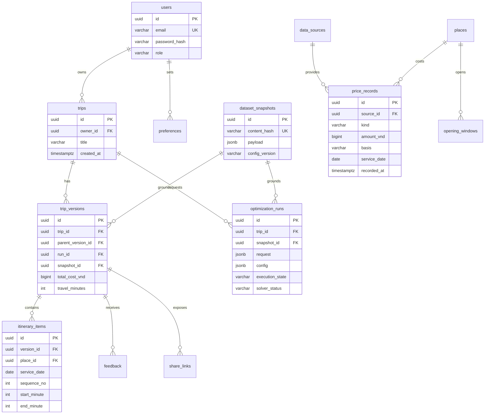

# Database design — Target PostgreSQL

Chỉ thiết kế; FE hiện tại không dùng database. UUID là ID target, fixture dùng chuỗi dễ đọc; API chỉ ràng buộc string để adapter không phụ thuộc dạng UUID. Timestamp dùng timestamptz UTC khi lưu; ngày dịch vụ và phút địa phương lưu riêng, timezone chuyến đi cố định Asia/Ho_Chi_Minh.

## Data dictionary
| Bảng | Trường chính, khóa và ý nghĩa |
|---|---|
| users | id PK UUID, email UNIQUE, password_hash, role traveler/admin, display_name, is_active, created_at |
| preferences | user_id FK users, interest_code; composite PK(user_id,interest_code) |
| places | id PK, name, category, latitude/longitude nullable khi chưa xác minh, duration_minutes>0, source_id FK, updated_at |
| opening_windows | id PK, place_id FK, service_date, open_minute>=0, close_minute<=1440, open<close, source_id FK |
| data_sources | id PK, name, status verified/unverified/simulated, license_url nullable, verification_notes, recorded_at |
| price_records | id PK, place_id nullable FK, source_id FK, kind observed/estimated/simulated, amount_vnd BIGINT>=0, basis per_person/per_group, currency VND, recorded_at, service_date, valid_from/to, conditions, estimate_method nullable |
| dataset_snapshots | id PK, content_hash UNIQUE, payload JSONB đầy đủ nơi/giờ/ma trận/giá, config_version, created_at; bất biến |
| trips | id PK, owner_id FK users, title, created_at, archived_at nullable |
| optimization_runs | id PK, trip_id FK, snapshot_id FK, parent_version_id nullable, request JSONB, config JSONB, execution_state QUEUED/RUNNING/COMPLETED/FAILED, solver_status nullable, stop_reason, checks JSONB, error_code, started_at/ended_at |
| trip_versions | id PK, trip_id FK, version_no>0, parent_version_id nullable FK self, run_id UNIQUE FK, snapshot_id FK, request JSONB, total_cost_vnd>=0, travel_minutes>=0, solver_status, cost_items JSONB, created_at; UNIQUE(trip_id,version_no) |
| itinerary_items | id PK, version_id FK, service_date, sequence_no, place_id FK, start_minute/end_minute, arrival_travel_minutes; UNIQUE(version_id,place_id), UNIQUE(version_id,service_date,sequence_no) |
| feedback | id PK, version_id FK, user_id FK, useful, comment, created_at; UNIQUE(version_id,user_id) |
| share_links | id PK, version_id FK, token_hash UNIQUE, expires_at, revoked_at nullable; không lưu token plaintext |

Snapshot payload là bản sao dữ kiện chuẩn hóa tại lúc publish, không join dữ liệu live để tái dựng lịch cũ. Travel edges/fixed costs nằm trong payload; tương lai tách bảng nếu cần truy vấn khối lượng lớn. Giá theo nhiều đêm được chuẩn hóa thành line item tổng đúng số đêm trước đưa vào solver.

## Toàn vẹn và ownership
Transaction ghi run + version + itinerary cùng nhau sau validator; không tạo version nếu chưa có nghiệm. API lấy trip.owner_id và kiểm tra ở mọi đường dẫn con. parent_version_id phải cùng trip; snapshot của result phải khớp run. Composite FK hoặc transaction validation ngăn parent/run thuộc trip khác. Unique version_no được cấp trong transaction có khóa hàng trip; xung đột trả 409, không last-write-wins.

Không UPDATE/DELETE snapshot đã tham chiếu trong luồng thông thường; điều chỉnh tạo version mới. Admin chỉnh catalog chỉ ảnh hưởng snapshot tương lai. Chặn sửa version ở application và DB permissions/trigger khi triển khai. Lưu giải thích xung đột trong run, không đưa plan vi phạm vào trip_versions.

## Index, retention và bảo vệ
Index trips(owner_id,created_at), trip_versions(trip_id,version_no), optimization_runs(trip_id,started_at), price_records(place_id,service_date,recorded_at), opening_windows(place_id,service_date), share_links(token_hash). Chỉ thêm JSONB GIN nếu workload chứng minh cần.

Password hash dùng thuật toán phù hợp như Argon2id khi triển khai, không lưu password; không log token hoặc yêu cầu nhạy cảm nguyên bản. Retention dữ liệu cá nhân cần chính sách thống nhất trước production; xóa tài khoản phải thu hồi share và xử lý trips/snapshots liên quan, không đặt thời hạn pháp lý giả định. Dữ liệu nghiên cứu nên khử định danh trước export. FE localStorage chỉ chứa dữ liệu demo, có nút xóa riêng namespace.
