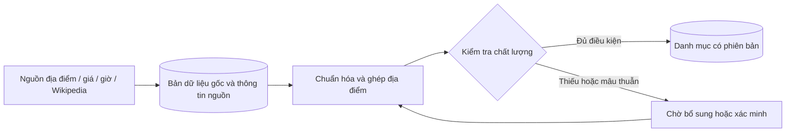
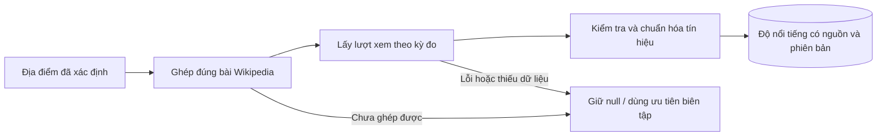
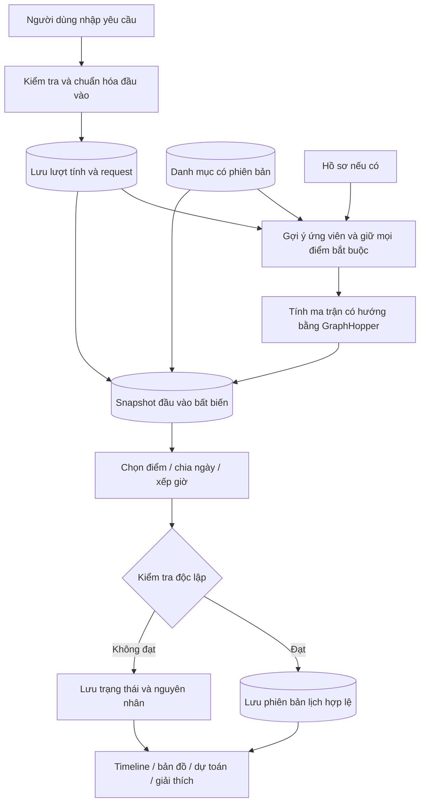

# Luồng dữ liệu SmartTripAI

Tài liệu mô tả cách hệ thống hoàn chỉnh thu thập dữ liệu, gợi ý địa điểm, tạo lịch và tiếp nhận phản hồi. Phần cuối đối chiếu với bản đang chạy để phân biệt chức năng đã có và phần cần phát triển.

## 1. Phạm vi và đầu ra

Người dùng chọn thành phố, nhập số ngày và có thể bổ sung ngân sách, các điểm bắt buộc hoặc giờ đi chơi. Hệ thống trả lịch theo ngày gồm địa điểm, giờ đến/rời, thời gian di chuyển, bản đồ và dự toán có nguồn.

Bản hiện tại hỗ trợ Hà Nội, Huế và Đà Nẵng, từ 1–14 ngày. Khung giờ mặc định dùng chung cho chuyến đi là 08:00–22:00, nghỉ trưa 12:00–13:00; người dùng có thể chỉnh hoặc tắt nghỉ. Ngân sách tính cho một người, gồm vé tham quan và di chuyển giữa các điểm trong ngày.

Trong hệ thống đầy đủ, hồ sơ sở thích, giá lưu trú và hành vi người dùng giúp mở rộng chất lượng gợi ý. Những dữ liệu này không làm thay đổi đầu vào bắt buộc của [phạm vi hiện đã duyệt](../superpowers/specs/2026-11-06-city-itinerary-design.md).

## 2. Sáu nhóm dữ liệu

| Nhóm | Nội dung chính | Dùng để gợi ý | Dùng để tối ưu | Ưu tiên |
|---|---|---|---|---|
| **POI — Điểm du lịch** | ID, tên, tọa độ, loại hình, thời lượng ghé, giờ hoạt động, quan hệ giữa các điểm; độ nổi tiếng khi có | Tạo ứng viên và đánh giá sức hấp dẫn | Chọn điểm, xếp thời gian, tránh trùng trải nghiệm | Bắt buộc |
| **User Profile — Hồ sơ sở thích** | Loại hình yêu thích, nhịp độ du lịch và các ưu tiên người dùng cung cấp | Cá nhân hóa điểm phù hợp | Điều chỉnh mục tiêu ưu tiên của lịch | Tùy chọn; cần khi cá nhân hóa |
| **Travel Constraints — Yêu cầu chuyến đi** | Thành phố, số ngày, ngân sách, điểm bắt buộc/loại trừ, khung giờ và nghỉ | Lọc ứng viên phù hợp yêu cầu | Ràng buộc mà lịch phải đáp ứng | Bắt buộc; một số trường có thể bỏ trống |
| **Prices — Chi phí** | Vé, quy tắc tính phí di chuyển; lưu trú và khoản khác khi mở rộng; đơn vị và thời gian hiệu lực | Ưu tiên điểm phù hợp ngân sách | Tính dự toán và kiểm tra giới hạn chi phí | Cần khi tính tiền hoặc kiểm tra ngân sách |
| **Travel Matrix — Ma trận di chuyển** | Thời gian và khoảng cách theo hướng, phương tiện, phiên bản mạng đường | Có thể giúp đánh giá khả năng ghép tuyến | Tính thứ tự, giờ đến/rời và chi phí chặng | Bắt buộc cho các chặng giữa điểm |
| **User Interactions — Hành vi người dùng** | Xem, chọn/bỏ điểm, lưu lịch và phản hồi | Đánh giá, học và cải thiện gợi ý | Không bắt buộc để kiểm tra lịch khả thi | Giai đoạn sau |

Hồ sơ là sở thích tương đối ổn định; yêu cầu chuyến đi áp dụng cho một lần đi cụ thể. Sở thích không tự trở thành ràng buộc cứng nếu người dùng chưa yêu cầu. Không có hồ sơ, hệ thống vẫn gợi ý theo thành phố và mức ưu tiên chung.

Độ nổi tiếng Wikipedia là thông tin bổ sung cho POI. Hành vi người dùng trong SmartTrip là nguồn khác; chỉ cân nhắc CF/GNN khi đã có dữ liệu và đánh giá phù hợp, chưa mặc định chọn một mô hình.

## 3. Dữ liệu đến từ đâu?

| Nguồn | Dữ liệu nhận được | Phần cần bổ sung hoặc kiểm tra |
|---|---|---|
| **OpenStreetMap** | Địa điểm, tọa độ, loại hình, các tag có sẵn và dữ liệu đường | Ghép đúng thực thể, chọn điểm vào phù hợp; không mặc định có đủ giá/giờ |
| **Đơn vị quản lý và nguồn được phép sử dụng** | Giá vé, điều kiện giá, giờ hoạt động và ngày đóng cửa | Phạm vi áp dụng, thời gian hiệu lực và độ mới |
| **Wikipedia / Wikidata / Pageviews** | Bài viết liên quan, định danh và lượt xem khi truy cập được | Đúng đối tượng, cùng kỳ đo và ngôn ngữ trước khi so sánh |
| **Quản trị dữ liệu** | Xác minh địa điểm, thời lượng ghé, ưu tiên và ước tính còn thiếu | Ghi rõ phần xác minh, phần biên tập và phương pháp ước tính |
| **Ứng dụng SmartTrip** | Hồ sơ, yêu cầu chuyến đi và tương tác | Gắn đúng người dùng/phiên bản, kiểm soát quyền và thu thập tối thiểu |

GraphHopper nhận dữ liệu đường OSM và tọa độ để **tính** ma trận tuyến. Nó không cung cấp giá vé, giờ mở cửa hay độ nổi tiếng.

## 4. Luồng chuẩn bị dữ liệu

Luồng này chạy khi nhập nguồn mới hoặc cập nhật định kỳ. Kết quả là một phiên bản danh mục đủ điều kiện phục vụ gợi ý; không phải mỗi lần tạo lịch đều thu thập lại từ Internet.

Các bước xử lý:

1. **Lưu nguồn gốc:** bản dữ liệu nhận được, thời điểm thu thập và thông tin nguồn.
2. **Chuẩn hóa:** ID, tên, tọa độ, tiền tệ, đơn vị giá và giờ địa phương.
3. **Ghép thực thể:** ánh xạ ID OSM và ID nguồn khác vào một địa điểm nội bộ. Kiểm tra tên, vị trí, loại và quan hệ quần thể; không gộp chỉ vì tên giống nhau.
4. **Kiểm tra:** phát hiện thiếu dữ liệu, giá/giờ hết hiệu lực, trùng điểm hoặc thông tin mâu thuẫn. Bản ghi chưa đạt được đưa vào danh sách cần xử lý.
5. **Publish:** phát hành phiên bản danh mục cùng thông tin nguồn và chất lượng. Điểm đủ dữ liệu để hiển thị có thể vẫn chưa đủ để kiểm tra ngân sách hoặc giờ hoạt động.

Mỗi dữ kiện cần nguồn, thời điểm ghi nhận, thời gian hiệu lực nếu có và nhãn **ghi nhận / ước tính / giả lập**. Xác minh tọa độ không đồng nghĩa đã xác minh giá và giờ. Thiếu giá khác với miễn phí; chưa biết giờ khác với đóng cửa.

### Dữ liệu độ nổi tiếng

Không dùng bài nhân vật cho tượng đài, trang định hướng cho điểm tham quan hoặc lượt xem cả quần thể làm số liệu của từng bộ phận. Không so trực tiếp lượt xem tiếng Anh với tiếng Việt. Khi thiếu dữ liệu, giữ `null`; không tự tạo thứ hạng hoặc thay bằng 0 lượt xem.

[Khảo sát Wikipedia](../research/2026-11-06-wikipedia-popularity-survey.md) đã ghép được 14/30 điểm, nhưng API trả HTTP 403 nên chưa có lượt xem thực. Dữ liệu này hiện chỉ phục vụ ghép bài, chưa tham gia xếp hạng.

## 5. Luồng tạo lịch cho một chuyến đi

Các lỗi dữ liệu hoặc định tuyến được trả ngay ở bước phát hiện; nhánh lỗi cuối sơ đồ mô tả trường hợp kết quả tính không qua kiểm tra.

### 5.1. Chuẩn hóa yêu cầu

Backend kiểm tra thành phố, số ngày, ngân sách, giờ và ID điểm bắt buộc. Áp dụng mặc định rồi lưu request thực tế đã dùng. Ngân sách bỏ trống nghĩa là không giới hạn; ngân sách 0 là giới hạn đúng bằng 0.

Trong kiến trúc đích, API tạo lượt tính (`runId`), worker xử lý và giao diện theo dõi trạng thái. Run được lưu bền vững; retry phải tránh tạo trùng phiên bản lịch. Bản hiện tại vẫn xử lý trực tiếp qua API, chưa có worker/database.

**Để kiểm tra giờ theo ngày thực tế:** cần ngày khởi hành nhằm xác định thứ trong tuần, ngày lễ và giá theo ngày. Đây là phần mở rộng cần thống nhất; đầu vào chỉ có số ngày hiện vẫn sử dụng dữ liệu tham khảo có nhãn.

### 5.2. Gợi ý ứng viên

Recommendation đọc POI, yêu cầu chuyến đi, hồ sơ nếu có và các tín hiệu độ nổi tiếng/chi phí hợp lệ. Đầu ra gồm ID điểm, các thành phần điểm phù hợp và lý do gợi ý.

Danh sách ứng viên luôn bao gồm mọi điểm bắt buộc. Cắt danh sách theo điểm xếp hạng không được làm mất những điểm này. Nếu điểm bắt buộc thiếu dữ liệu cần thiết, hệ thống báo rõ để bổ sung hoặc sửa yêu cầu.

Recommendation đánh giá mức đáng ghé; optimizer quyết định những điểm nào ghép thành lịch khả thi. Trọng số kết hợp độ nổi tiếng, sở thích và ưu tiên biên tập cần được đánh giá trước khi chốt.

### 5.3. Tính tuyến và tạo snapshot

GraphHopper tính thời gian và khoảng cách cho các cặp ứng viên theo phương tiện đã chọn. A→B và B→A được lưu riêng. Cache phải phân biệt tọa độ, hướng, profile và phiên bản mạng đường.

Snapshot đóng băng request, ứng viên, giờ/giá/thời lượng, điểm gợi ý, ma trận, nguồn và cấu hình thuật toán. Dữ liệu mới không thay đổi snapshot của lượt đang tính. Geometry các chặng được chọn phải cùng phiên bản và khớp metrics dùng để lập lịch.

Lỗi dịch vụ khác với tuyến được xác nhận không có đường. Có thể loại chặng tùy chọn lỗi và ghi nhận nguyên nhân; nếu chưa kiểm tra được yêu cầu bắt buộc thì báo không tính được tuyến. Không thay dữ liệu thiếu bằng 0 hoặc đường chim bay.

### 5.4. Tối ưu và kiểm tra

Optimizer chọn điểm, chia ngày, xếp thứ tự và giờ ghé dựa trên snapshot. Validator tính lại từ dữ liệu snapshot để kiểm tra:

- Đủ điểm bắt buộc; không lặp điểm hoặc trải nghiệm bị loại trừ.
- Giờ ghé/chặng không chồng lấn, phù hợp khung ngày, giờ hoạt động và khoảng nghỉ.
- Các chặng có hướng đúng và đủ thời gian di chuyển.
- Tổng vé và phí chặng đúng đơn vị, không vượt ngân sách nếu có.
- Nguồn, phiên bản tuyến và geometry khớp kết quả.

Chỉ kết quả đạt kiểm tra mới được lưu thành phiên bản lịch hợp lệ. Mỗi kết quả cần phân biệt lịch tạo được theo dữ liệu/giả định, xung đột có chứng cứ, chưa tìm thấy trong giới hạn, lỗi dữ liệu và lỗi định tuyến. Ngày trống phải được báo rõ, không lặp điểm để lấp lịch.

### 5.5. Hiển thị và điều chỉnh

API trả timeline, tuyến, từng dòng chi phí, tổng và nguồn để giao diện hiển thị thống nhất. Frontend không gọi lại nguồn khác để âm thầm đổi giờ, tuyến hoặc tổng tiền.

Sửa yêu cầu tạo lượt tính mới; lưu lịch điều chỉnh tạo v2 liên kết v1. Dữ liệu nguồn cập nhật không tự sửa phiên bản đã lưu. Giao diện bỏ response cũ khi người dùng đổi đầu vào; hủy request phía trình duyệt không đồng nghĩa worker đã dừng.

## 6. Lưu trữ và vòng phản hồi

| Dữ liệu | Cách lưu ở kiến trúc đích | Mục đích |
|---|---|---|
| Bản nguồn và ánh xạ địa điểm | Dữ liệu gốc, nguồn, hash và ID nội bộ/OSM/nhà cung cấp | Đối chiếu, cập nhật và xử lý trùng |
| POI, giá, giờ, thời lượng, popularity | Dữ kiện có nguồn, hiệu lực và phiên bản | Phục vụ danh mục và gợi ý |
| Ma trận/geometry | Cache theo cặp có hướng và graph/profile | Tái sử dụng tuyến đúng phiên bản |
| Hồ sơ và request | Hồ sơ người dùng tách khỏi yêu cầu từng chuyến | Cá nhân hóa và tái hiện yêu cầu |
| Run và snapshot | Trạng thái xử lý, cấu hình và đầu vào bất biến | Truy vết lỗi, kiểm tra và tái lập kết quả |
| Chuyến đi và phiên bản | Chủ sở hữu, lịch hợp lệ, snapshot ID và phiên bản cha | Xem lại, so sánh và điều chỉnh |
| Tương tác và phản hồi | Gắn đúng điểm/lịch/phiên bản, theo quyền truy cập | Đánh giá và cập nhật gợi ý về sau |

PostgreSQL là lựa chọn đích trong [thiết kế database](DATABASE_DESIGN.md). Các nhóm trên là mô hình logic; không cần tách mỗi nhóm thành một dịch vụ riêng. FastAPI và worker có thể dùng chung các module nghiệp vụ.

Phản hồi đi vào đánh giá hoặc cập nhật mô hình/feature ở lần phát hành sau, không trực tiếp sửa lịch đã lưu. Phân quyền theo chủ chuyến đi; quản trị danh mục không mặc nhiên có quyền đọc chuyến riêng của người khác.

Nếu bổ sung AI Agent, chat được chuyển thành request có cấu trúc rồi gọi cùng luồng API. Agent có thể hỏi thông tin thiếu và diễn giải kết quả; số liệu và tính khả thi vẫn do dữ liệu, routing và validator quyết định. Form tiếp tục hoạt động khi Agent không khả dụng.

## 7. Đối chiếu với bản hiện tại

| Thành phần | Hiện trạng | Phần cần hoàn thiện |
|---|---|---|
| POI | 30 điểm OSM của ba thành phố trong JSON | Xác minh danh tính, điểm vào và độ phủ |
| Giá/giờ/thời lượng | Ước tính biên tập có nhãn | Nguồn thực tế, hiệu lực và quy trình cập nhật |
| Recommendation | Ưu tiên biên tập và đa dạng trải nghiệm trong heuristic lập lịch | Tách điểm thành phần, đánh giá và bổ sung popularity/hồ sơ |
| Routing và lập lịch | FastAPI, GraphHopper, heuristic và validator đã có | Phiên bản dữ liệu đường và cache bền vững |
| Wikipedia | Có khảo sát ghép bài | Lấy lượt xem qua API được phép và đánh giá tín hiệu |
| Pipeline, run và snapshot | Chưa có quy trình bền vững đầy đủ | Ingest/publish, database, worker và snapshot bất biến |
| Lưu lịch | LocalStorage phục vụ lịch demo; lịch mới chưa lưu | Lưu version lịch mới và ownership thực |
| Hồ sơ/hành vi/Agent | Chưa có trong luồng mới | Triển khai theo giai đoạn sau |

Ưu tiên tiếp theo: xác minh POI/giá/giờ → lưu trữ và phiên bản dữ liệu → run/snapshot bền vững → lưu lịch và phân quyền → bổ sung tín hiệu gợi ý → đo chất lượng trước khi mở rộng mô hình.
