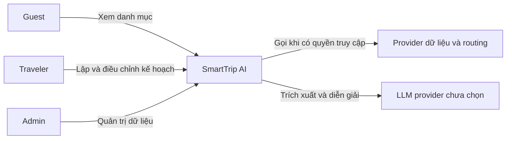

# C1 — System context

M và L là dependency target, chưa có key/quyền truy cập. Agent không trực tiếp chỉnh DB hoặc bỏ ràng buộc. Bên ngoài không nhận dữ liệu riêng người dùng quá mức cần thiết. Prototype không gọi M/L, không có backend.
