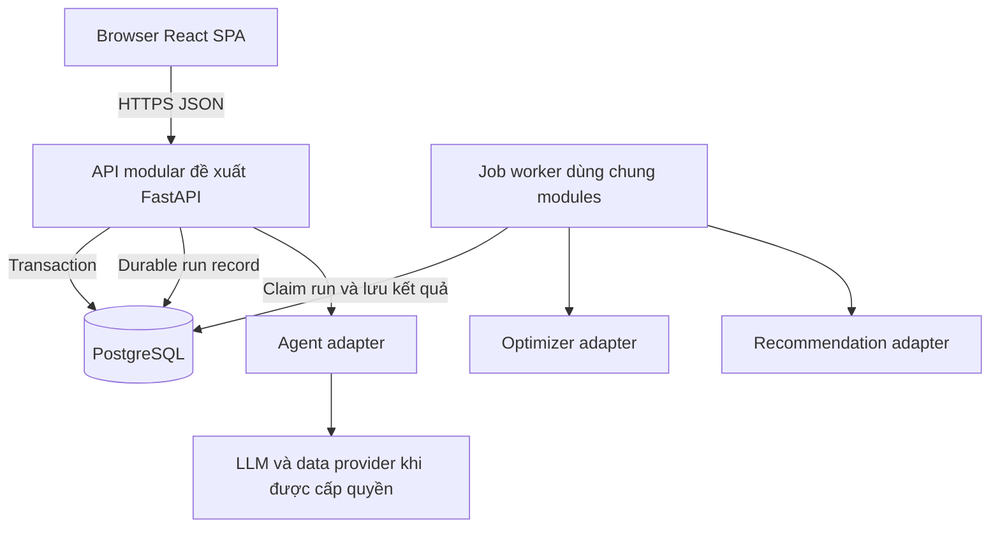

# C2 — Containers target và prototype

FastAPI/Python và PostgreSQL là đề xuất cho backend tương lai, không cài trong đợt này. Worker claim run có lease, heartbeat và retry idempotent; không coi in-process background task là queue bền vững. Solver chạy có giới hạn thời gian và validator trước commit. Kiến trúc modular monolith + worker tránh tách microservices khi chưa cần.

Prototype thực tế: trình duyệt → React → mockTravelService → JSON fixture; lưu localStorage. Vite chỉ dev/build/static server, không phải backend API. HTTPS, RBAC, durable jobs và DB không được giả lập như bảo mật thật.
