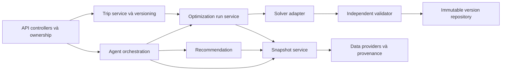

# C3 — Modules

Recommendation dùng content-based ở MVP, nhận preference + snapshot và trả ranked candidates/relevanceScore; thuật toán có thể đổi sau. Agent nhận natural language, xuất draft TravelRequest rồi yêu cầu xác nhận; tool calls giới hạn theo quyền actor. Optimizer nhận request đã xác nhận và snapshot, không tự tìm dữ liệu web hay dùng LLM cộng tiền. Validator đọc dữ liệu gốc để tính lại, độc lập với đường tính tổng của solver. Repository chỉ lưu version sau validator pass. Audit run ghi trạng thái, config và lỗi; không log nội dung riêng quá mức cần.

Nếu LLM lỗi, form có cấu trúc vẫn dùng được. Nếu solver lỗi/timeout, không giả kết quả; có thể giữ lịch version trước. Nếu nguồn lỗi, trả DATA_ERROR thay vì bịa dữ liệu.

