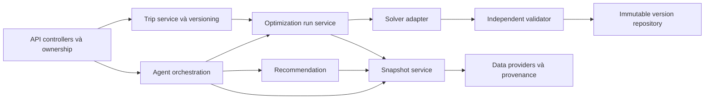

# C3 — Modules

Recommendation dùng content-based ở MVP, nhận preference + snapshot và trả ranked candidates/relevanceScore; thuật toán có thể đổi sau. Agent nhận natural language, xuất draft TravelRequest rồi yêu cầu xác nhận; tool calls giới hạn theo quyền actor. Optimizer nhận request đã xác nhận và snapshot, không tự tìm dữ liệu web hay dùng LLM cộng tiền. Validator đọc dữ liệu gốc để tính lại, độc lập với đường tính tổng của solver. Repository chỉ lưu version sau validator pass. Audit run ghi trạng thái, config và lỗi; không log nội dung riêng quá mức cần.

Nếu LLM lỗi, form có cấu trúc vẫn dùng được. Nếu solver lỗi/timeout, không giả kết quả; có thể giữ lịch version trước. Nếu nguồn lỗi, trả DATA_ERROR thay vì bịa dữ liệu.

## Đặc tả module Optimization Engine

Trạng thái: mô hình đề xuất, chưa triển khai solver. FE chỉ đọc fixture. Đây là bài toán chọn điểm và xây tuyến nhiều ngày có lợi ích, time windows và ngân sách, gần với multi-day orienteering có ràng buộc; không phải TSP bắt buộc ghé mọi điểm.

## 1. Đầu vào và đơn vị
`TravelRequest`: destination, startDate/endDate (inclusive), partySize, budgetVnd tổng nhóm, dayStartMinute/dayEndMinute, depotId, interests, mandatoryPlaceIds, excludedPlaceIds, lockedVisits. Ngày tính giờ địa phương Asia/Ho_Chi_Minh; phút nguyên từ 00:00 mỗi ngày. Các trường giờ hiển thị ISO date + phút để tránh đổi UTC ngầm. Mỗi ngày độc lập, không có hoạt động qua đêm.

`DatasetSnapshot`: snapshotId, recordedAt, places, windows theo ngày, durations, directed travelMinutes và distanceKm, costs/provenance, relevanceScore theo request, version cấu hình. Không giả định ma trận đối xứng. Dữ liệu thiếu trên cung có thể dùng phải báo DATA_ERROR hoặc loại cung theo chính sách công khai; MVP yêu cầu ma trận đầy đủ giữa các điểm ứng viên và depot. Tọa độ không đủ suy ra thời gian đường thực.

Chi phí không âm, VND nguyên; thời lượng phục vụ >=1 phút. Nếu ngân sách nhỏ hơn fixed cost, có chứng cứ vô nghiệm từ kiểm tra tiền trước solver. Chi phí lưu trú/ăn uống dự trù cố định F đã xác định cho nhóm. Phí điểm và phí cung phân biệt per_person/per_group; nhân partySize đúng một lần. Giá estimated/simulated không được hiển thị là giá đặt dịch vụ.

## 2. Tập, tham số và biến
- D: tập ngày; N: địa điểm ứng viên, không bao gồm depot.
- M/E: tập bắt buộc/loại trừ; M giao E rỗng; M phải nằm trong N.
- Với mỗi ngày d, s_d và t_d là hai bản sao depot đầu/cuối. A_d gồm s→N, N→N (i khác j), N→t và s→t; không có cung vào s hoặc ra t.
- H_d/L_d: phút bắt đầu/kết thúc ngày; [o_idk,c_idk]: cửa sổ k của điểm i ngày d; v_i: thời gian phục vụ; tau_ij: phút di chuyển, tau_s,t=0; q_i trong [0,1000] là điểm phù hợp đã chuẩn hóa theo request.
- c_i: tổng phí thăm điểm cho nhóm; c_ij: tổng phí di chuyển trên cung cho nhóm; F: tổng fixed costs.
- y_id ∈ {0,1}: chọn i vào ngày d; x_ijd ∈ {0,1}: đi cung i→j; a_id ∈ [0,1440]: bắt đầu phục vụ; z_idk chọn cửa sổ; u_id ∈ [0,|N|]: thứ tự tuyến. a_s=H_d, v_s=0; a_t là giờ quay về.

## 3. Ràng buộc
### Chọn điểm và dòng tuyến
sum_d y_id <= 1 với mọi i. Với i thuộc M: sum_d y_id=1; với i thuộc E: sum_d y_id=0.

Mỗi ngày: sum_j x_sjd=1, sum_i x_itd=1. Cung s→t cho phép ngày rỗng, không cần gán điểm giả. Với mỗi i∈N: sum_j x_ijd = sum_j x_jid = y_id. Không có self-loop.

### Liên thông, loại chu trình con
0 <= u_id <= |N| y_id và u_id >= y_id. Với mọi cung i→j giữa điểm thực, nếu x_ijd=1 thì u_jd >= u_id+1. Kết hợp cân bằng dòng và thứ tự tăng ngăn cycle tách khỏi depot. Không dùng u cho s/t. Có thể dùng reified constraints thay big-M trong CP-SAT.

### Thời gian và mở cửa
Nếu x_ijd=1: a_jd >= a_id + v_i + tau_ij. a_t nằm trong [H_d,L_d]. Với điểm được chọn, sum_k z_idk=y_id, z_idk=1 ⇒ o_idk <= a_id và a_id+v_i <= c_idk. Không có cửa sổ trong ngày thì y_id=0. Giờ kết thúc chuyến ghé phải nằm trong cửa sổ, không chỉ giờ đến.

a_id cũng nằm trong [H_d,L_d] nếu được chọn; thời gian chờ là khoảng dư giữa đến sớm nhất và bắt đầu phục vụ, không tự sinh chi phí âm. Lịch ngày rỗng trả departure=return=H_d, travel=0. Solver có thể có slack; canonicalize lịch đến sớm nhất theo thứ tự tuyến trong các cửa sổ đã chọn, rồi validator kiểm tra lại. Không xê dịch locked visits.

### Ngân sách
F + sum_id c_i y_id + sum_d,(i,j) c_ij x_ijd <= B.

F phải gồm tất cả khoản cố định đã thỏa thuận (số đêm lưu trú, ăn uống dự trù, dự phòng nếu có). Không thêm khoản đó lần nữa trong phí điểm/cung. B là tổng nhóm; tổng mỗi người chỉ là giá trị chia P để hiển thị, không áp ràng buộc trên số đã làm tròn.

### Locked visits và replanning
`lockedVisits` chứa placeId/date/startMinute, thường là phần đã thực hiện. Khóa y_id=1 và a_id bằng giá trị đã chốt; luôn suy ra thứ tự prefix từ parentVersionId đã xác thực, không tin thứ tự do client gửi. Với prefix p1..pk đã thực hiện: khóa x_s,p1,d=1 và x_pj,pj+1,d=1 cho j<k, cùng y/time như cha; không cho chèn điểm trước p1 hoặc giữa hai điểm prefix. Phần còn lại bắt đầu tại pk với giờ rời đã chốt, chỉ cung ra pk được tối ưu tiếp. Nếu ngày đã hoàn thành, khóa cả cung pk→t và return time. Từ chối lockedVisits không tạo prefix liên tục của lịch cha hoặc khác giờ/ngày, trả INVALID_INPUT; không tự biến thành khóa rời. Bản thiết kế MVP chỉ khóa prefix đầu ngày, không tùy ý khóa các đoạn rời. Chi phí đã chi và travel đã thực hiện vẫn nằm trong tổng B, không được trừ mất. Request mới lưu parentVersionId và snapshotId; thay snapshot phải khai báo khác dữ liệu, không dùng để tuyên bố cải thiện thuật toán.

## 4. Hàm mục tiêu, chuẩn hóa và hòa điểm
Ưu tiên tính khả thi trước; không dùng phạt mềm để che vi phạm hard constraint.

Đề xuất score nguyên: S=700R+200V−100T, mỗi thành phần trong [0,1000]. R=floor(1000 sum q_i y_id / max(1,sum_{i∈N\E}q_i)); V=floor(1000 C_visited/max(1,C_available)), nhóm loại hình lấy từ tập hợp category, mỗi điểm có một category chính để tránh đếm đôi. T=floor(1000 sum tau_ij x_ijd / max(1,sum_d(L_d−H_d))). Feasible schedule làm T<=1000. Mẫu số cố định theo request, không đổi theo số điểm được chọn. Khi q toàn 0, R=0. Diversity chỉ đếm loại có thể chọn, excluded không góp vào mẫu số.

CP-SAT dùng biểu thức integer và biến phụ cho phép chia/làm tròn hoặc quy đồng trọng số, ghi rõ objectiveVersion. Sau max S, tie-break tuần tự: min travel, min cost, rồi thứ tự ID tuyến theo ngày (lexicographic, không gộp trọng số lớn dễ overflow). Chỉ chuyển giai đoạn khi chứng minh optimum giai đoạn trước; nếu hết giờ trả incumbent và mô tả giai đoạn/bound, không gọi lex optimum. Các trọng số 700/200/100 là cấu hình nghiên cứu đề xuất, cần sensitivity analysis chứ chưa được chứng minh tốt nhất.

## 5. Hai hướng giải
### Baseline greedy có validator
Khởi tạo ngày rỗng, đặt mandatory bằng insertion khả thi theo thứ tự ưu tiên q giảm, ID tăng khi hòa. Sau đó chèn điểm tùy chọn vào vị trí khả thi có tỷ lệ ΔS/max(1,ΔtravelMinutes) lớn nhất với S theo mục 4 và cùng mẫu số cố định theo request. Chỉ chèn optional khi ΔS>0. Hòa tỷ lệ: chọn ΔS lớn hơn, Δtravel nhỏ hơn, cost tăng ít hơn, ngày sớm hơn, vị trí chèn nhỏ hơn, placeId tăng dần. Dừng khi không còn insertion khả thi có ΔS>0 hoặc hết time budget. Mandatory có thể làm giảm S nhưng vẫn phải thỏa hard constraints. Cập nhật thời gian/cost sau mỗi chèn. Không chèn được mandatory chỉ báo baseline chưa tìm được lịch, không kết luận bài toán vô nghiệm. Greedy là baseline yếu và có thể bỏ lỡ nghiệm; đây là điều benchmark cần bộc lộ.

### Hướng chính đề xuất: CP-SAT
Phù hợp biến Boolean chọn điểm và constraints lịch; hạn chế quy mô ứng viên là cấu hình benchmark, không khẳng định xử lý mọi dữ liệu. Routing solver với time dimension là phương án đối chiếu, nhưng cần thêm chọn điểm/ngân sách/lợi ích; ví dụ VRPTW chính thức không phải toàn bộ bài toán SmartTrip. Không triển khai solver trong đợt này.

Khởi điểm nghiên cứu: seed=42, một worker cho thí nghiệm tái lập, time budget 10s/run trên phần cứng được ghi; đây là protocol dự kiến, không SLA hay thời gian FE mô phỏng. Ghi phiên bản OR-Tools, solver parameters, candidate count, input hash, objectiveVersion, elapsed time và objective bound.

## 6. Trạng thái và hợp đồng kết quả
| Trạng thái hệ thống | Ý nghĩa | Có plan? |
|---|---|---|
| OPTIMAL | Solver chứng minh tối ưu cho objective/giai đoạn được công bố | Có |
| FEASIBLE | Có nghiệm vượt validator, chưa chứng minh tối ưu | Có |
| TIMEOUT_WITH_SOLUTION | Hết budget nhưng có incumbent hợp lệ | Có |
| TIMEOUT_NO_SOLUTION | Hết budget, chưa có nghiệm | Không |
| INFEASIBLE | Có chứng cứ solver hoặc precheck không thể đáp ứng | Không |
| INVALID_INPUT | Request sai logic/cú pháp | Không |
| DATA_ERROR | Thiếu dữ liệu hoặc validator từ chối output | Không |

CP-SAT trả OPTIMAL/FEASIBLE/INFEASIBLE/MODEL_INVALID/UNKNOWN; adapter cần xét stop reason và incumbent để ánh xạ trạng thái ứng dụng. MODEL_INVALID do mô hình lập trình sai là lỗi nội bộ, không đổ cho người dùng bằng INVALID_INPUT. UNKNOWN không mặc định timeout: ghi reason khác nếu không đạt time limit. Prototype chỉ diễn kịch bản đã định nghĩa.

Result gồm runId, request/snapshot/config version, status/reason, constraintChecks (pass/fail/unknown, evidence), plan hoặc null, skippedPlaces gồm placeId/reason nếu có và metadata isMock. Không tuyên bố tìm được minimal conflict set nếu không có công cụ chứng minh; có thể trả một xung đột đã xác minh như fixedCost>B.

## 7. Validator độc lập
Đọc snapshot + request + lịch, không tin tổng do solver trả. Kiểm tra: ID/date hợp lệ; mỗi điểm tối đa một lần; mandatory/excluded; depot và liên thông; service đủ lâu; a_j>=end_i+tau; window chứa cả service; ngày không tràn; locked prefix bất biến; cộng cost từ cost items theo basis, travel đủ cả lượt về; tổng <=B. Kiểm tra plan chỉ đi kèm trạng thái có nghiệm. Nếu fail lưu run DATA_ERROR với diagnostic, không lưu version khả thi.

Checker fixture trong repo chỉ kiểm tra ví dụ được trình bày; validator production là module thiết kế chưa triển khai. Không coi fixture checker là solver.

## 8. Ví dụ và giới hạn
2 người, fixedCost=1.600.000 (lưu trú 1.000.000 theo nhóm + ăn uống 300.000 mỗi người). Ngày 1: depot 08:00 → Mỹ Khê 08:20–09:20 → Chợ Hàn 09:35–10:20 → depot 10:40. Travel=20+15+20=55 phút; service=105 phút; kết thúc 640 phút. Chi phí được cộng từ JSON fixture; xem [kịch bản FE](../../../frontend/README.md), không dùng giá này để mua dịch vụ.

Mô hình bỏ qua traffic theo thời điểm, thời tiết xác suất, chờ xếp hàng không xác định và tối ưu khách sạn. Buffer hoặc thay nguồn được biểu diễn thành dữ liệu/cấu hình, không dùng lời hứa độ chính xác.

## Nguồn kỹ thuật
Kiểm tra ngày 02/11/2026: [CP-SAT chính thức](https://developers.google.com/optimization/cp/cp_solver) xác nhận constraints integer và trạng thái solver; [VRPTW chính thức](https://developers.google.com/optimization/routing/vrptw) minh họa time matrix/time windows. Mô hình SmartTrip và hàm mục tiêu trên là đề xuất của đề tài, không phải mô hình được các nguồn này xác nhận cho dữ liệu du lịch.
